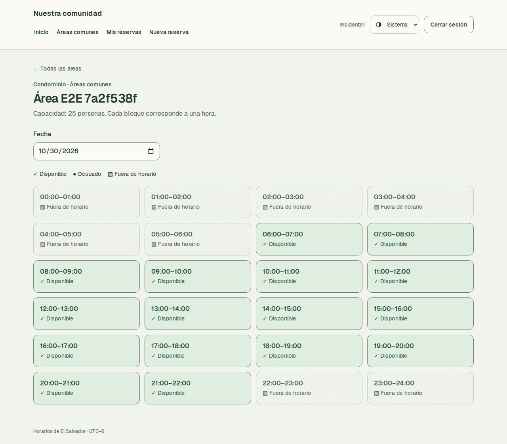
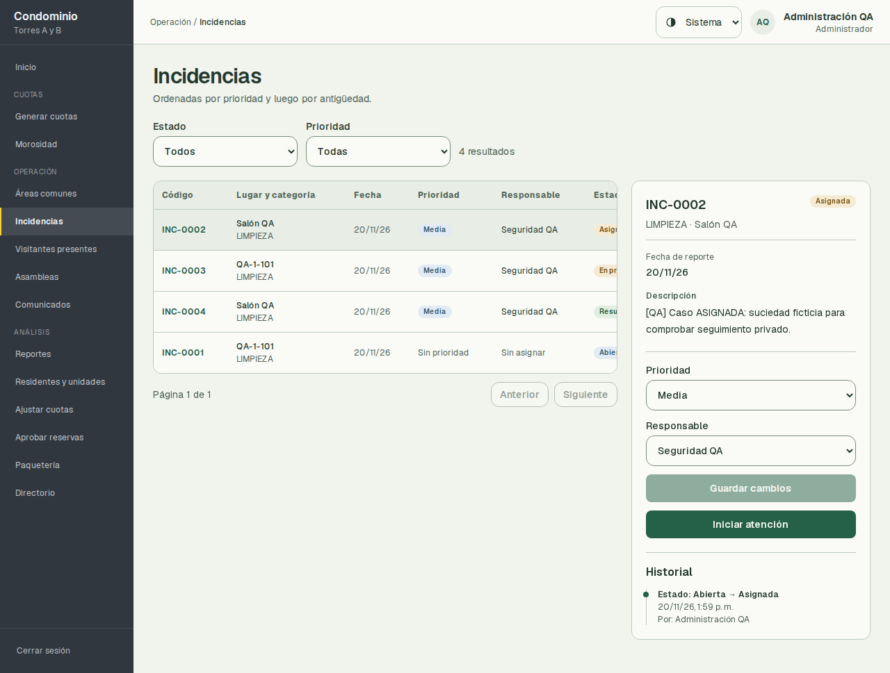
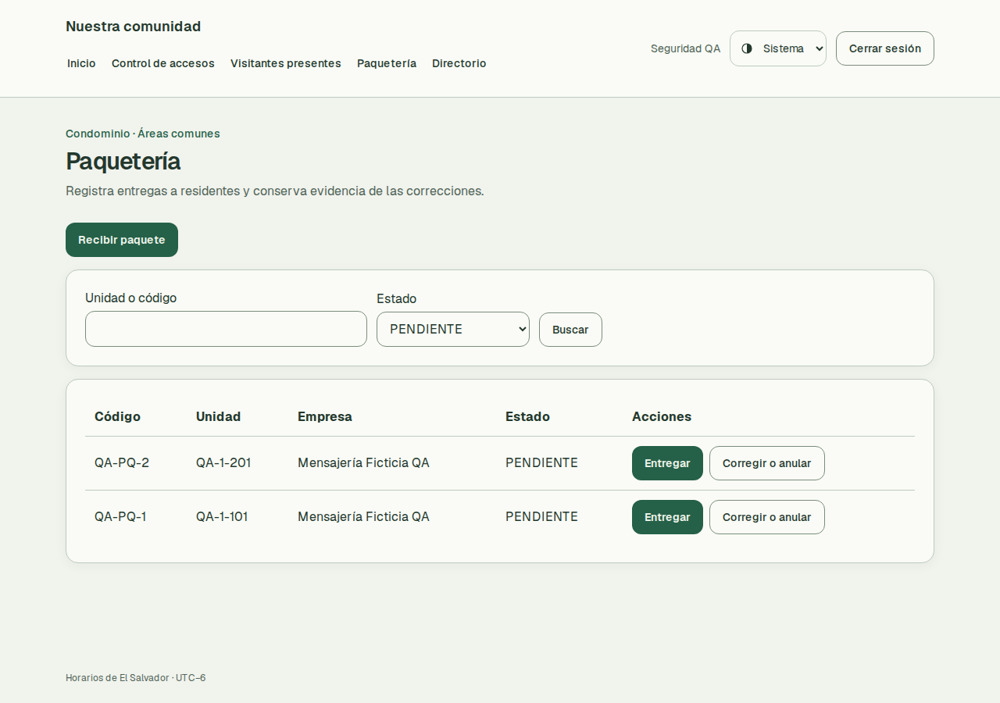
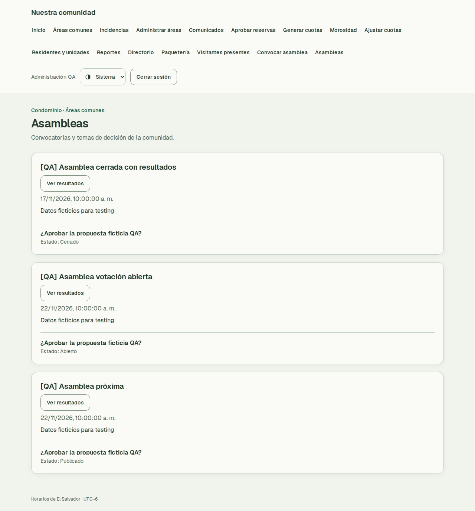
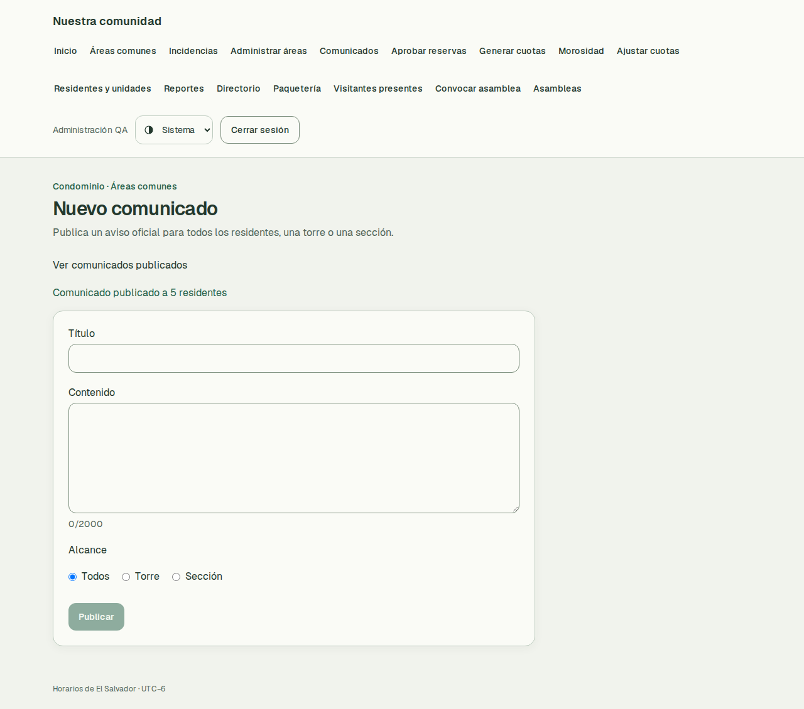
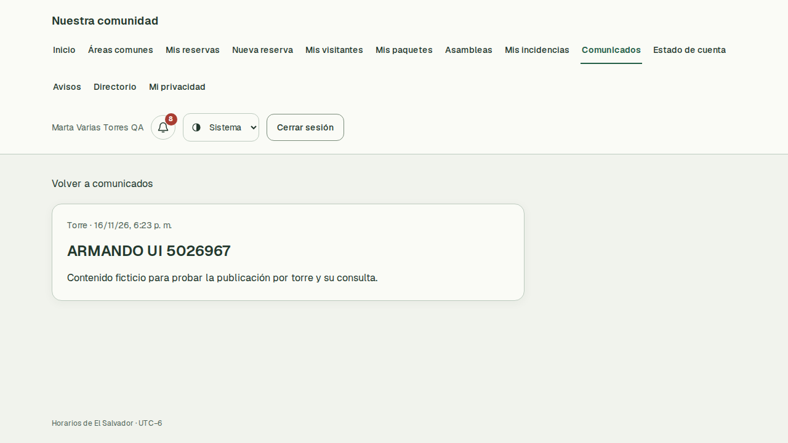
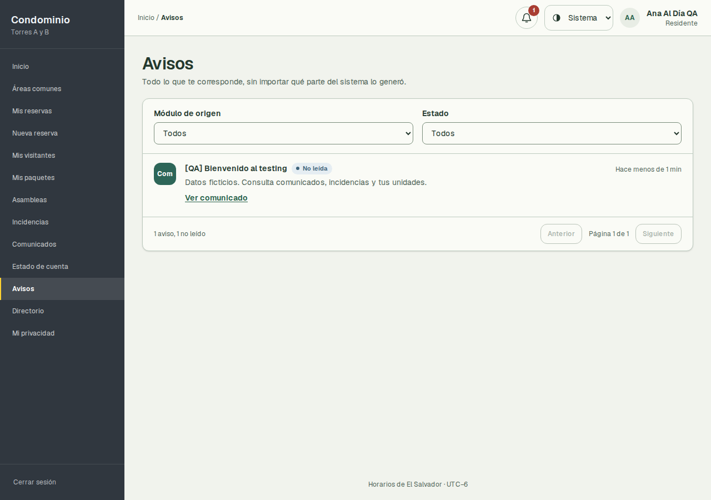

# Guía de uso

## Roles y acceso

| Rol | Facultades |
|---|---|
| Administrador | Alta y vinculación de residentes; cuotas y morosidad; áreas y aprobación de reservas; incidencias; asambleas; comunicados y reportes. |
| Residente | Sus cuotas, reservas, incidencias, visitas y paquetes; voto de sus unidades; comunicados pertinentes, directorio y avisos. |
| Seguridad | Autorizaciones y movimientos de visitas, paquetes e incidencias asignadas; consulta del directorio según privacidad. |

Entrar en /login con las credenciales entregadas privadamente. El administrador registra residentes y los vincula a una o varias unidades. No hay registro público. La sesión se guarda en cookie HttpOnly; en HTTPS es Secure. Se puede elegir tema claro, oscuro o del sistema.

## Cuotas y pagos (H1–H4)

Administración: Cuotas → elegir período → revisar previa → generar. Tarifa fija global y recargo único del 5%. Se pueden corregir/anular cuotas pendientes, con motivo. Residente: Estado de cuenta → seleccionar unidad si tiene varias → detalle → pagar el total → revisar resultado/comprobante. El pago es una simulación, no un cobro bancario; no introducir tarjetas reales. Usar datos de la pasarela de prueba documentada en los DTO/Swagger. Administración consulta Morosidad para el resumen y detalle de unidades.

## Reservas (H5–H8)

Administración crea un área en /admin/areas, su capacidad y franjas semanales. Residente: Áreas → disponibilidad → día y bloque disponible → revisar el resumen fijo → duración y asistentes → solicitar. La reserva queda Pendiente; no ocupa definitivamente el bloque hasta que administración la aprueba en /admin/reservas. Las deudas vencidas bloquean solicitud y aprobación. Límite de dos confirmadas futuras por creador. Mis reservas solo muestra las propias; cancelar exige al menos 24 horas de anticipación y confirmación en diálogo. No eliminar las áreas para cambiar horarios: se editan o desactivan sin borrar reservas históricas.

## Incidencias (H9–H12)

Residente: Incidencias → Reportar → unidad o área, categoría, descripción y hasta las fotografías admitidas. Mis incidencias muestra solo sus reportes, filtro y detalle con estado/historial/fotos privadas. Administración: Incidencias → seleccionar → prioridad y responsable → guardar; iniciar atención cuando esté Asignada y marcar Resuelta desde En proceso, confirmando cada transición. Las acciones requieren guardar o descartar la edición pendiente. El aviso al residente permite abrir el seguimiento.

## Visitas (H13–H15)

Residente: Mis visitantes → preautorizar nombre y apellido con ventana de fechas; puede cancelar una autorización vigente no utilizada. Seguridad: Control de accesos → buscar autorización → registrar entrada → registrar salida. Una autorización admite ingresos sucesivos durante su vigencia, con un solo ingreso abierto a la vez. Si llega sin autorización, seguridad solicita confirmación a un residente de la unidad y espera la aprobación; no basta registrar la llegada. Visitantes presentes filtra por unidad o nombre.

## Paquetería (H16–H19)

Seguridad: recepción → unidad, empresa y descripción → registrar. Los residentes de esa unidad reciben aviso. Consultar pendientes e historial. Para entregar, elegir un residente activo del catálogo de la unidad y verificar su identidad contra la plataforma; no se entrega a terceros. Administración puede corregir/anular errores con motivo y conserva auditoría. Una recepción cuyo aviso falla se revierte; reintentar según el error.

## Asambleas y votaciones (H20–H22)

Administración: Asambleas → crear convocatoria y agenda → añadir temas, opciones y apertura/cierre → publicar. Residente: Asambleas → tema abierto → elegir opción y unidad → confirmar voto. Solo cuenta el primer voto de cualquier residente de cada unidad; no se bloquea por morosidad ni se exige quórum. Los resultados se consultan al cerrar; la administración puede auditar la opción de los votos nuevos. Los históricos que no guardaron opción identificable no se reconstruyen.

## Comunicados (H23–H24)

Administración: Comunicados → Nuevo → título, contenido y alcance Todos/Torre/Sección → revisar audiencia → confirmar publicación. No se edita un comunicado publicado. Residente: Comunicados → lista paginada y detalle. Si pertenece a distintas torres, verá los destinos de todas sus unidades, incluidos comunicados anteriores a su ingreso. No se exige confirmación de lectura del comunicado.

## Directorio (H25–H26)

Residente: Mi privacidad → decidir visibilidad de nombre, teléfono, correo y unidad. Directorio permite a los tres roles buscar contactos que aceptaron aparecer, respetando los campos autorizados. La privacidad puede cambiarse después de publicar.

## Avisos (H27–H28)

Residente: campana → últimos avisos, o Avisos → filtrar por módulo y estado. Abrir el destino pertinente y marcar el aviso como leído; esto es diferente a confirmar lectura de comunicados, que no se exige. Las notificaciones son internas; correo electrónico no está implementado.

## Reportes (H29–H30)

Administración: Reportes → elegir Desde/Hasta (máximo 366 días) → Aplicar. Se muestran morosidad, uso de áreas, incidencias abiertas y participación, distinguiendo cero de Sin datos. Compartir/descargar genera PDF general de solo lectura con el mismo cálculo y período. La administración lo puede distribuir a residentes; no hay enlaces públicos con tokens ni información financiera individual en el PDF.

Capturas de cuotas, incidencias, visitas, paquetes, asambleas, directorio, avisos y reportes: release local del 20/11/2026 con datos sintéticos. Las de reservas y comunicados documentan el recorrido de pruebas del 16/11/2026. No muestran credenciales.
