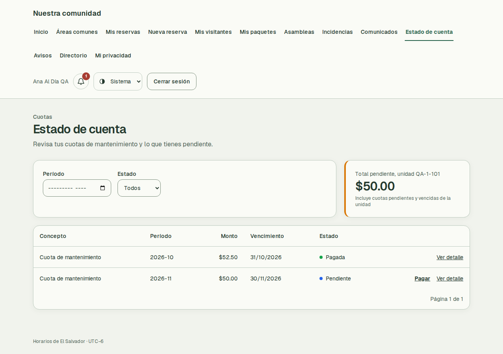
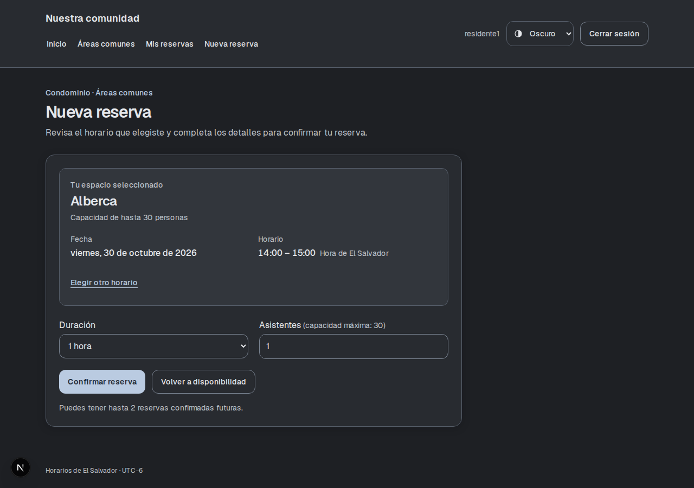
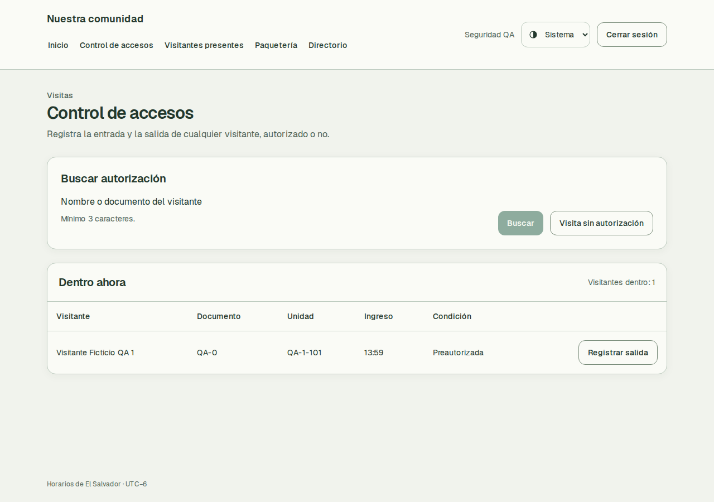
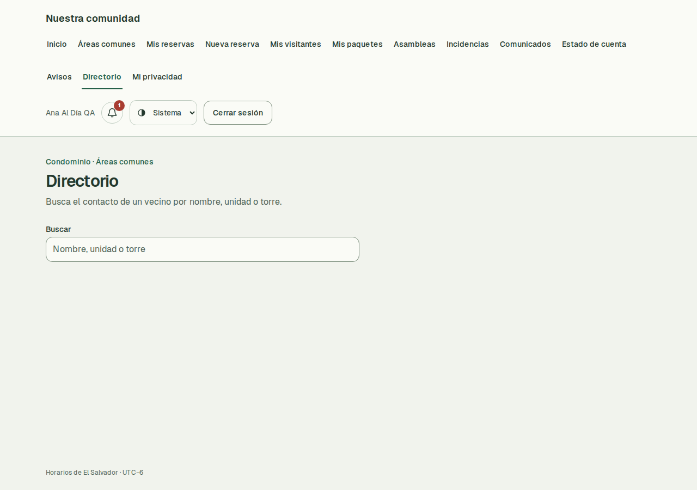
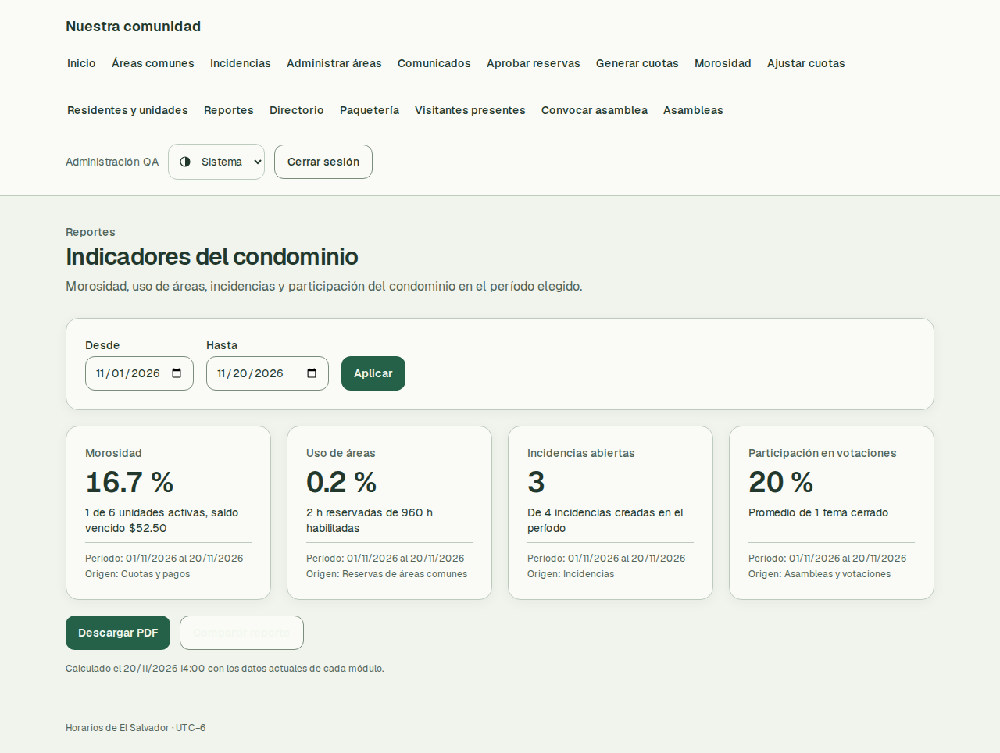

# Guía de uso

## Roles

| Rol | Qué puede hacer |
|---|---|
| Administrador | Alta y vinculación de residentes; cuotas y morosidad; áreas y aprobación de reservas; incidencias; asambleas; comunicados y reportes. |
| Residente | Sus cuotas, reservas, incidencias, visitas y paquetes; voto de sus unidades; comunicados pertinentes, directorio y avisos. |
| Seguridad | Autorizaciones y movimientos de visitas, paquetes e incidencias asignadas; consulta del directorio según privacidad. |

Entrar en /login con las credenciales entregadas privadamente. El administrador registra residentes y los vincula a una o varias unidades. No hay registro público. La sesión se guarda en cookie HttpOnly; en HTTPS es Secure. Se puede elegir tema claro, oscuro o del sistema.

## Flujos principales

### Módulo 1: Cuotas y pagos

#### Flujo principal

1. Administración: Cuotas → elegir período → revisar previa → generar.
2. Tarifa fija global y recargo único del 5%.
3. Se pueden corregir/anular cuotas pendientes, con motivo.
4. Residente: Estado de cuenta → seleccionar unidad si tiene varias → detalle → pagar el total → revisar resultado/comprobante.
5. El pago es una simulación, no un cobro bancario; no introducir tarjetas reales.
6. Usar datos de la pasarela de prueba documentada en los DTO/Swagger.
7. Administración consulta Morosidad para el resumen y detalle de unidades.

### Módulo 2: Reservas

#### Flujo principal

1. Administración crea un área en /admin/areas, su capacidad y franjas semanales.
2. Residente: Áreas → disponibilidad → día y bloque disponible → revisar el resumen fijo → duración y asistentes → solicitar.
3. La reserva queda Pendiente; no ocupa definitivamente el bloque hasta que administración la aprueba en /admin/reservas.
4. Las deudas vencidas bloquean solicitud y aprobación.
5. Límite de dos confirmadas futuras por creador.
6. Mis reservas solo muestra las propias; cancelar exige al menos 24 horas de anticipación y confirmación en diálogo.
7. No eliminar las áreas para cambiar horarios: se editan o desactivan sin borrar reservas históricas.

### Módulo 3: Incidencias

#### Flujo principal

1. Residente: Incidencias → Reportar → unidad o área, categoría, descripción y hasta las fotografías admitidas.
2. Mis incidencias muestra solo sus reportes, filtro y detalle con estado/historial/fotos privadas.
3. Administración: Incidencias → seleccionar → prioridad y responsable → guardar; iniciar atención cuando esté Asignada y marcar Resuelta desde En proceso, confirmando cada transición.
4. Las acciones requieren guardar o descartar la edición pendiente.
5. El aviso al residente permite abrir el seguimiento.

### Módulo 4: Visitas

#### Flujo principal

1. Residente: Mis visitantes → preautorizar nombre y apellido con ventana de fechas; puede cancelar una autorización vigente no utilizada.
2. Seguridad: Control de accesos → buscar autorización → registrar entrada → registrar salida.
3. Una autorización admite ingresos sucesivos durante su vigencia, con un solo ingreso abierto a la vez.
4. Si llega sin autorización, seguridad solicita confirmación a un residente de la unidad y espera la aprobación; no basta registrar la llegada.
5. Visitantes presentes filtra por unidad o nombre.

### Módulo 5: Paquetería

#### Flujo principal

1. Seguridad: recepción → unidad, empresa y descripción → registrar.
2. Los residentes de esa unidad reciben aviso.
3. Consultar pendientes e historial.
4. Para entregar, elegir un residente activo del catálogo de la unidad y verificar su identidad contra la plataforma; no se entrega a terceros.
5. Administración puede corregir/anular errores con motivo y conserva auditoría.
6. Una recepción cuyo aviso falla se revierte; reintentar según el error.

### Módulo 6: Asambleas y votaciones

#### Flujo principal

1. Administración: Asambleas → crear convocatoria y agenda → añadir temas, opciones y apertura/cierre → publicar.
2. Residente: Asambleas → tema abierto → elegir opción y unidad → confirmar voto.
3. Solo cuenta el primer voto de cualquier residente de cada unidad; no se bloquea por morosidad ni se exige quórum.
4. Los resultados se consultan al cerrar; la administración puede auditar la opción de los votos nuevos.
5. Los históricos que no guardaron opción identificable no se reconstruyen.

### Módulo 7: Comunicados

#### Flujo principal

1. Administración: Comunicados → Nuevo → título, contenido y alcance Todos/Torre/Sección → revisar audiencia → confirmar publicación.
2. No se edita un comunicado publicado.
3. Residente: Comunicados → lista paginada y detalle.
4. Si pertenece a distintas torres, verá los destinos de todas sus unidades, incluidos comunicados anteriores a su ingreso.
5. No se exige confirmación de lectura del comunicado.

### Módulo 8: Directorio

#### Flujo principal

1. Residente: Mi privacidad → decidir visibilidad de nombre, teléfono, correo y unidad.
2. Directorio permite a los tres roles buscar contactos que aceptaron aparecer, respetando los campos autorizados.
3. La privacidad puede cambiarse después de publicar.

### Módulo 9: Avisos

#### Flujo principal

1. Residente: campana → últimos avisos, o Avisos → filtrar por módulo y estado.
2. Abrir el destino pertinente y marcar el aviso como leído; esto es diferente a confirmar lectura de comunicados, que no se exige.
3. Las notificaciones son internas; correo electrónico no está implementado.

### Módulo 10: Reportes

#### Flujo principal

1. Administración: Reportes → elegir Desde/Hasta (máximo 366 días) → Aplicar.
2. Se muestran morosidad, uso de áreas, incidencias abiertas y participación, distinguiendo cero de Sin datos.
3. Compartir/descargar genera PDF general de solo lectura con el mismo cálculo y período.
4. La administración lo puede distribuir a residentes; no hay enlaces públicos con tokens ni información financiera individual en el PDF.

Capturas de cuotas, incidencias, visitas, paquetes, asambleas, directorio, avisos y reportes: release local del 20/11/2026 con datos sintéticos. Las de reservas y comunicados documentan el recorrido de pruebas del 16/11/2026. No muestran credenciales.
