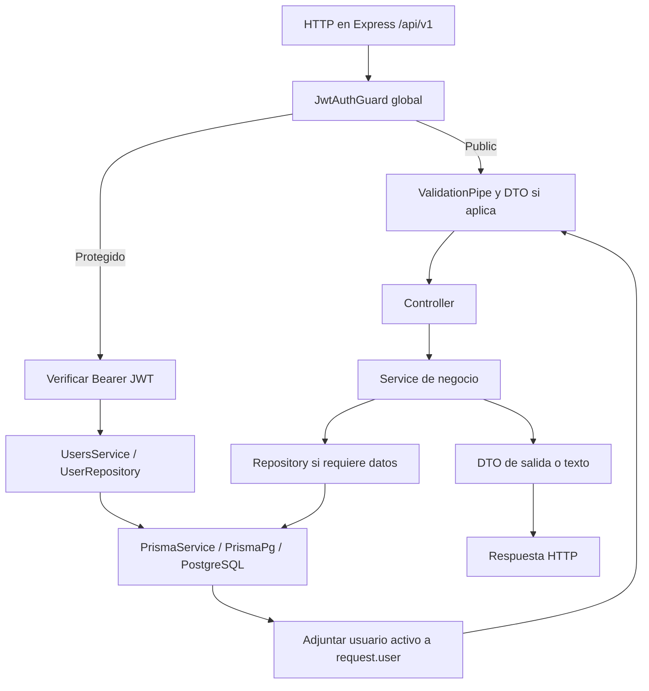

# Arquitectura actual del backend

## Organización

La aplicación es un monolito modular NestJS. [AppModule](../src/app.module.ts) importa ConfigModule global con caché y validación, PrismaModule, HealthModule, UsersModule y AuthModule. No se encontraron módulos de condominios ni servicios independientes desplegables por dominio.

```text
src/
  main.ts                 bootstrap HTTP, prefijo, validación y Swagger
  app.module.ts           composición y guard global
  config/                 validación y tipo EnvConfig
  common/decorators/      normalización y validación de email
  health/                 controller, service y prueba
  users/                  controller, DTOs, service, repository y error de dominio
  auth/                   controller, DTOs, services, repository, guard y decoradores
  prisma/                 módulo global y PrismaService
prisma/                   schema, migraciones y seed
test/                     prueba e2e
```

## Módulos y dependencias

| Módulo | Componentes concretos | Responsabilidad |
|---|---|---|
| HealthModule | HealthController, HealthService | Respuesta simple de disponibilidad HTTP |
| UsersModule | UsersController, UsersService, UserRepository | Registro, hashing y acceso a usuarios; exporta service y repository |
| AuthModule | AuthController, AuthService, TokenService, RefreshTokenRepository, JwtAuthGuard | Autenticación, emisión/rotación/revocación de tokens; importa UsersModule y JwtModule asíncrono |
| PrismaModule | PrismaService global | Cliente Prisma y ciclo de conexión |
| ConfigModule | ConfigService con validateEnv | Dependencias y configuración desde entorno |

Fuentes: [HealthModule](../src/health/health.module.ts), [UsersModule](../src/users/users.module.ts), [AuthModule](../src/auth/auth.module.ts), [PrismaModule](../src/prisma/prisma.module.ts).

## Recorrido de una petición



El diagrama representa llamadas y retorno conceptual; no todas las rutas consultan la base. Health devuelve texto, y `/auth/me` utiliza el usuario cargado por el guard. En login, `@Public()` omite el guard y AuthService consulta credenciales mediante UsersService antes de emitir tokens. En registro, el service hashea y delega la inserción a UserRepository.

[main.ts](../src/main.ts) crea la aplicación y establece el prefijo literal `api/v1` (no usa versionado dinámico de Nest). El [guard](../src/auth/guards/jwt-auth.guard.ts) usa Reflector para leer `@Public()`. En rutas protegidas verifica el JWT y relee al usuario, rechazando cuentas inexistentes o inactivas; agrega la entidad a `request.user`. [CurrentUser](../src/auth/decorators/current-user.decorator.ts) la extrae en el controller.

Después del guard, el ValidationPipe global aplica transformación, whitelist y rechazo de propiedades extra. Los controladores construyen DTOs explícitos de salida para excluir passwordHash. PrismaService extiende PrismaClient y usa PrismaPg con DATABASE_URL; [sus hooks](../src/prisma/services/prisma.service.ts) conectan al iniciar el módulo y desconectan al destruirlo. `enableShutdownHooks()` habilita el cierre desde Nest.

## Patrones efectivamente implementados

- Inyección de dependencias por constructor con módulos y providers `@Injectable()`.
- Separación controller → service → repository → ORM, con repositorios concretos; no hay interfaces de repositorio inyectadas mediante tokens propios.
- DTOs y mapeadores estáticos `from` / `fromEntity` para contrato público.
- Guard global de autenticación y decoradores de metadatos/contexto.
- Traducción de error de persistencia: P2002 → EmailAlreadyTakenError → ConflictException ([repository](../src/users/repositories/user.repository.ts), [service](../src/users/services/users.service.ts)). Los tipos User de Prisma siguen presentes en servicios, por lo que no existe aislamiento total del ORM.

## Excepciones y componentes ausentes

Los services y el guard lanzan excepciones Nest (`UnauthorizedException`, `ConflictException`); la validación puede rechazar con 400. No hay filters, interceptors ni middlewares propios registrados; las respuestas de errores dependen del manejo estándar de Nest, sin contrato personalizado uniforme para toda excepción. Los errores de base no traducidos no tienen mapeo propio y pueden terminar como 500.

No se configura CORS en main. Tampoco hay autorización por roles, auditoría, rate limiting, colas, event bus, scheduler ni patrón outbox implementados. CQRS, microservicios, eventos de dominio o repositorios genéricos serían propuestas nuevas, no descripciones del boilerplate. Se recomienda conservar la organización actual como punto de partida y justificar cualquier ampliación con el módulo asignado.
