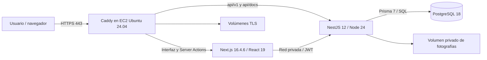

# Arquitectura

## Vista general

## Stack

TypeScript; Next.js 16.4.6 y React 19.2.8; NestJS 12, Swagger y validación de DTO; Prisma 7 con adapter-pg; PostgreSQL 18. Docker Engine y Compose V2; Caddy 2; Ubuntu Server 24.04 amd64 en EC2. Los package-lock fijan dependencias, y deploy/base-images.env fija las imágenes por digest. Vitest y Playwright para pruebas.

## Estructura

Backend: src/auth, users, prisma, reservas, cuotas, incidencias, visitas, paquetes, asamblea, comunicados, directorio, notificaciones, reportes, administracion y health; prisma/schema.prisma y migrations; test/ para HTTP; deploy/ para Compose, servidor, seed y respaldo; docs/ para manuales.

Frontend: app/ para rutas, Server Actions y proxies privados; components/ por módulo; lib/ para contratos/sesión; tests/ para componentes/reglas y e2e/ para navegador.

## Decisiones

| Decisión | Alternativa | Motivo |
|---|---|---|
| Un único condominio y vínculos N:M | Multiempresa | Alcance del PO; permite varias unidades/residentes sin duplicar usuarios. |
| Next en servidor y JWT en cookie HttpOnly | JWT en localStorage | El JavaScript del navegador no recibe el token; las acciones autorizan en servidor. |
| API pública mediante Caddy, autorización en Nest | Abrir directamente el puerto 3000 | HTTPS y origen único; BD/API internas sin puertos de servicio públicos. |
| PostgreSQL, transacciones e índices | Validar solo en UI | Impide carreras en reservas, votos, entregas y pagos. |
| Migraciones antes del arranque | db push/reset | Evolución auditable sin borrar usuarios ni historia. |
| Imágenes por SHA y digest | Tags latest | Permite identificar y repetir exactamente una pareja frontend/backend. |
| Construir fuera de EC2 pequeña | Compilar ambos en 2 GiB | Reduce presión de memoria; imágenes importadas por SSH. |
| Respaldo de BD y fotos con pausa | Copias separadas en vivo | Conserva consistencia; mantenimiento breve documentado. |

Limitaciones: una sola VM es punto único de fallo; no hay prueba de carga ni alta disponibilidad. S3 es opcional y no está configurado. Detalle: [decisiones de despliegue](despliegue/DECISIONES.md).
