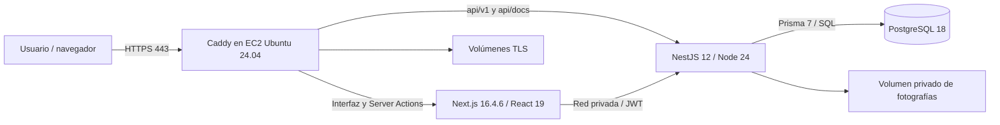

# Arquitectura

## Vista general



## Stack

| Capa | Tecnología | Versión |
|---|---|---|
| Frontend | Next.js / React | 16.4.6 / 19.2.8 |
| Backend | NestJS / Node.js | 12.0.3 / 24 |
| ORM | Prisma / adaptador PostgreSQL | 7.10.1 / 7.10.0 |
| Base de datos | PostgreSQL | 18 |
| Contenedores | Docker Engine / plugin Compose | 29.1.3 / 5.6.1 en el entorno local verificado |
| HTTPS y proxy | Caddy | 2, imagen fijada por digest |
| Servidor | Ubuntu Server, amd64 | 24.04 LTS |

Las versiones de dependencias exactas están en package-lock.json; las imágenes base se fijan en deploy/base-images.env. Los comandos utilizan `docker compose` (plugin; compatible con Compose V2 y posteriores), no el binario antiguo docker-compose.

## Estructura de carpetas

```text
be_boilerplate_is_2026/
├── src/
│   ├── auth/ users/ prisma/ health/ config/
│   ├── cuotas/ pagos/ reservas/ incidencias/ visitas/ paquetes/
│   └── asambleas/ comunicados/ directorio/ notificaciones/ reportes/ administracion/
├── prisma/
│   ├── schema.prisma
│   ├── migrations/
│   └── seed.ts
├── deploy/
│   ├── compose.production.yml / Caddyfile / Dockerfile en raíz
│   ├── local.py / plataforma.py / seed-demo.mjs
│   └── tests/ systemd/ aws/
├── test/
└── docs/
    ├── 01-guia-de-uso.md ... 09-problemas-conocidos.md
    └── img/

fe_boilerplate_is_2026/
├── app/
│   ├── (plataforma)/
│   ├── actions/
│   └── api/
├── components/
├── lib/
├── tests/
├── e2e/
└── docs/
```

## Decisiones técnicas

| Decisión | Alternativas consideradas | Motivo |
|---|---|---|
| Un único condominio y vínculos N:M | Multiempresa | Alcance del PO; permite varias unidades/residentes sin duplicar usuarios. |
| Next en servidor y JWT en cookie HttpOnly | JWT en localStorage | El JavaScript del navegador no recibe el token; las acciones autorizan en servidor. |
| API pública mediante Caddy, autorización en Nest | Abrir directamente el puerto 3000 | HTTPS y origen único; BD/API internas sin puertos de servicio públicos. |
| PostgreSQL, transacciones e índices | Validar solo en UI | Impide carreras en reservas, votos, entregas y pagos. |
| Migraciones antes del arranque | db push/reset | Evolución auditable sin borrar usuarios ni historia. |
| Imágenes por SHA y digest | Tags latest | Permite identificar y repetir exactamente una pareja frontend/backend. |
| Construir fuera de EC2 pequeña | Compilar ambos en 2 GiB | Reduce presión de memoria; imágenes importadas por SSH. |
| Respaldo de BD y fotos con pausa | Copias separadas en vivo | Conserva consistencia; mantenimiento breve documentado. |

Limitaciones: una sola VM es punto único de fallo; no hay prueba de carga ni alta disponibilidad. S3 es opcional y no está configurado. Detalle: [decisiones de despliegue](despliegue/DECISIONES.md).
