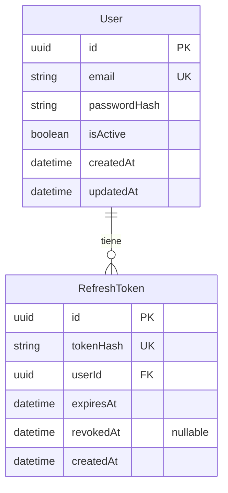

# Base de datos existente

Fuente principal: [prisma/schema.prisma](../prisma/schema.prisma). Describe el esquema versionado, no una inspección de una base en ejecución.

## Modelos, campos y restricciones

| Modelo / tabla | Campo Prisma → SQL | Tipo y restricciones |
|---|---|---|
| User / users | id → id | String UUID, PK, `@default(uuid())` |
| | email → email | String, obligatorio, único |
| | passwordHash → password_hash | String obligatorio; hash bcrypt según UsersService |
| | isActive → is_active | Boolean obligatorio, default true |
| | createdAt → created_at | DateTime obligatorio, default now |
| | updatedAt → updated_at | DateTime obligatorio, `@updatedAt` |
| | refreshTokens | Relación inversa; no es columna |
| RefreshToken / refresh_tokens | id → id | String UUID, PK, `@default(uuid())` |
| | tokenHash → token_hash | String obligatorio, único; SHA-256 según TokenService |
| | userId → user_id | UUID obligatorio, FK a users.id e índice no único |
| | expiresAt → expires_at | DateTime obligatorio, sin default |
| | revokedAt → revoked_at | DateTime nullable; null representa no revocado |
| | createdAt → created_at | DateTime obligatorio, default now |
| | user | Relación por userId; no es otra columna |

SQL materializado: UUID para identificadores, TEXT para strings, BOOLEAN y TIMESTAMP(3) sin zona horaria. `uuid()` y `@updatedAt` se gestionan desde Prisma; la migración no añade defaults SQL para UUID ni updated_at. No hay enums, roles, checks financieros, unidades o condominios.

## Relaciones e índices

Un User tiene cero o muchos RefreshToken; cada token pertenece a exactamente un User. La relación declara `onDelete: Cascade`; la FK SQL incluye ON DELETE CASCADE y ON UPDATE CASCADE. Eliminar un usuario elimina sus tokens asociados.

Índices resultantes: PK `users_pkey`, único `users_email_key`, PK `refresh_tokens_pkey`, único `refresh_tokens_token_hash_key` y no único `refresh_tokens_user_id_idx`. No existe índice sobre expires_at ni unicidad por unidad, porque esa entidad aún no existe. El email se normaliza en aplicación; el índice único no constituye por sí mismo una restricción case-insensitive.

El diagrama utiliza los nombres Prisma; los mapeos físicos están en la tabla anterior.

## Historial de migraciones

1. [20260920172640_init](../prisma/migrations/20260920172640_init/migration.sql): crea users con username, refresh_tokens, PKs, índices únicos, índice por usuario y FK.
2. [20260927163851_rename_username_to_email](../prisma/migrations/20260927163851_rename_username_to_email/migration.sql): renombra la columna a email y el índice a users_email_key; ejecuta `lower(trim(email))` sobre valores existentes. No elimina la columna, pero la normalización puede colisionar con el índice único si hay datos previos equivalentes tras normalizar. Renombrar tampoco garantiza que todos los antiguos usernames sean emails válidos.

No se aplicaron migraciones ni se comprobó `_prisma_migrations`; se desconoce el estado de cualquier base local o remota.

## Cliente, conexión y seed

El generador `prisma-client` produce TypeScript ESM en `src/generated/prisma`, con runtime nodejs y engineType client. El datasource declara PostgreSQL; la URL del CLI está en [prisma.config.ts](../prisma.config.ts) y la de ejecución en [PrismaService](../src/prisma/services/prisma.service.ts) mediante PrismaPg. [Compose](../docker-compose.yml) ofrece PostgreSQL 18 y persistencia en volumen; no se levantó.

[seed.ts](../prisma/seed.ts) hace upsert de un usuario demo con email, hash bcrypt de costo 12 y `update: {}`; volverlo a ejecutar no cambia el registro existente. Incluye credenciales de demostración y las imprime en consola; no deben tratarse como configuración de producción ni copiarse a esta documentación. El seed no crea roles.

## Reutilización y decisiones pendientes

User puede servir como identidad de residentes, administradores y personal de seguridad; RefreshToken mantiene sesiones. No conviene duplicar credenciales en futuros perfiles de negocio. Esto es una recomendación; el schema no contiene esas relaciones.

Deben discutirse condominio, torre/sección, unidad y pertenencia, con sus cardinalidades, historial y alcance de permisos. La representación de roles y la distinción usuario/unidad son especialmente relevantes para votar una vez por unidad. No se propone aquí un schema definitivo ni se presupone multi-tenencia. También quedan pendientes políticas de borrado/auditoría, moneda, zona horaria y responsables de migraciones compartidas.
