# Modelo de datos

Fuente: [schema.prisma](../prisma/schema.prisma). IDs UUID; importes Decimal USD; fechas de negocio en America/El_Salvador y timestamps UTC. Las migraciones preservan historial.

## Diagrama entidad-relación

```mermaid
erDiagram
    User {
        string id PK
        string email
        string passwordHash
        boolean isActive
        datetime createdAt
        datetime updatedAt
    }
    RefreshToken {
        string id PK
        string tokenHash
        string userId FK
        datetime expiresAt
        datetime revokedAt
        datetime createdAt
    }
    User ||--o{ RefreshToken : relacion
    Torre {
        string id PK
        string nombre
    }
    Seccion {
        string id PK
        string nombre
        string torreId FK
    }
    Torre ||--o{ Seccion : relacion
    Unidad {
        string id PK
        string codigo
        string torreId FK
        string seccionId FK
        decimal cuotaMensual
        boolean activa
    }
    Torre ||--o{ Unidad : relacion
    Seccion ||--o{ Unidad : relacion
    UsuarioUnidad {
        string id PK
        string userId FK
        string unidadId FK
    }
    User ||--o{ UsuarioUnidad : relacion
    Unidad ||--o{ UsuarioUnidad : relacion
    AreaComun {
        string id PK
        string nombre
        int capacidad
        boolean activa
        datetime createdAt
        datetime updatedAt
    }
    HorarioArea {
        string id PK
        string areaId FK
        int diaSemana
        string horaInicio
        string horaFin
    }
    AreaComun ||--o{ HorarioArea : relacion
    Reserva {
        string id PK
        string codigo
        string areaId FK
        string unidadId FK
        string userId FK
        datetime inicio
    }
    AreaComun ||--o{ Reserva : relacion
    Unidad |o--o{ Reserva : relacion
    User ||--o{ Reserva : relacion
    AutorizacionVisita {
        string id PK
        string residenteId FK
        string unidadId FK
        string visitanteNombre
        string visitanteDocumento
        datetime inicio
    }
    User ||--o{ AutorizacionVisita : relacion
    Unidad ||--o{ AutorizacionVisita : relacion
    Cuota {
        string id PK
        string unidadId FK
        string concepto
        string periodo
        decimal monto
        datetime fechaVencimiento
    }
    Unidad ||--o{ Cuota : relacion
    Pago {
        string id PK
        int numero
        string referencia
        string cuotaId FK
        string userId FK
        decimal monto
    }
    Cuota ||--o{ Pago : relacion
    User ||--o{ Pago : relacion
    Incidencia {
        string id PK
        string codigo
        string residenteId FK
        string lugarTipo
        string unidadId FK
        string areaId FK
        string responsableId FK
    }
    User ||--o{ Incidencia : relacion
    User |o--o{ Incidencia : relacion
    Unidad |o--o{ Incidencia : relacion
    AreaComun |o--o{ Incidencia : relacion
    EvidenciaIncidencia {
        string id PK
        string incidenciaId FK
        string ruta
        string mime
        int tamanoBytes
        datetime createdAt
    }
    Incidencia ||--o{ EvidenciaIncidencia : relacion
    HistorialIncidencia {
        string id PK
        string incidenciaId FK
        string campo
        string valorAnterior
        string valorNuevo
        string actorId FK
    }
    Incidencia ||--o{ HistorialIncidencia : relacion
    User ||--o{ HistorialIncidencia : relacion
    MovimientoVisita {
        string id PK
        string autorizacionId FK
        string unidadId FK
        string visitanteNombre
        string visitanteDocumento
        string condicion
        string ingresoPorId FK
        string salidaPorId FK
    }
    AutorizacionVisita |o--o{ MovimientoVisita : relacion
    Unidad ||--o{ MovimientoVisita : relacion
    User ||--o{ MovimientoVisita : relacion
    User |o--o{ MovimientoVisita : relacion
    Asamblea {
        string id PK
        string titulo
        datetime fechaAt
        string descripcion
        string estado
        string creadorId FK
    }
    User ||--o{ Asamblea : relacion
    TemaVotacion {
        string id PK
        string asambleaId FK
        string pregunta
        datetime aperturaAt
        datetime cierreAt
        boolean notificadoApertura
    }
    Asamblea ||--o{ TemaVotacion : relacion
    OpcionVoto {
        string id PK
        string temaId FK
        string texto
    }
    TemaVotacion ||--o{ OpcionVoto : relacion
    ParticipacionVoto {
        string id PK
        string temaId FK
        string unidadId FK
        string opcionId FK
        datetime createdAt
    }
    TemaVotacion ||--o{ ParticipacionVoto : relacion
    Unidad ||--o{ ParticipacionVoto : relacion
    OpcionVoto |o--o{ ParticipacionVoto : relacion
    Voto {
        string id PK
        string temaId FK
        string opcionId FK
    }
    TemaVotacion ||--o{ Voto : relacion
    OpcionVoto ||--o{ Voto : relacion
    Paquete {
        string id PK
        string codigo
        string unidadId FK
        string empresa
        string descripcion
        datetime recibidoAt
        string entregadoPorId FK
        string registradoPorId FK
    }
    Unidad ||--o{ Paquete : relacion
    User ||--o{ Paquete : relacion
    User |o--o{ Paquete : relacion
    Comunicado {
        string id PK
        string titulo
        string contenido
        string alcance
        string torreId FK
        string seccionId FK
        string autorId FK
    }
    Torre |o--o{ Comunicado : relacion
    Seccion |o--o{ Comunicado : relacion
    User ||--o{ Comunicado : relacion
    LecturaComunicado {
        string id PK
        string comunicadoId FK
        string userId FK
        datetime leidoAt
    }
    Comunicado ||--o{ LecturaComunicado : relacion
    User ||--o{ LecturaComunicado : relacion
    Notificacion {
        string id PK
        string userId FK
        string moduloOrigen
        string tipoEvento
        string titulo
        string mensaje
    }
    User ||--o{ Notificacion : relacion
    PreferenciaDirectorio {
        string userId PK,FK
        boolean visible
        boolean mostrarTelefono
        boolean mostrarCorreo
        boolean mostrarUnidad
        datetime updatedAt
    }
    User ||--o{ PreferenciaDirectorio : relacion
    AuditoriaAdministrativa {
        string id PK
        string actorId FK
        string recurso
        string recursoId
        string accion
        string motivo
    }
    User ||--o{ AuditoriaAdministrativa : relacion
```

## Tablas

| Tabla | Descripción | Campos importantes |
|---|---|---|
| User / users | Identidad, hash de contraseña, rol y estado activo. | id, email, passwordHash, isActive, createdAt, updatedAt |
| RefreshToken / refresh_tokens | Sesiones renovables, expiración y revocación. | id, tokenHash, userId, expiresAt, revokedAt, createdAt |
| Torre / Torre | Torres del condominio. | id, nombre |
| Seccion / Seccion | Secciones pertenecientes a una torre. | id, nombre, torreId |
| Unidad / Unidad | Unidad habitacional y catálogo. | id, codigo, torreId, seccionId, cuotaMensual, activa |
| UsuarioUnidad / UsuarioUnidad | Asociación N:M entre residentes y unidades. | id, userId, unidadId |
| AreaComun / AreaComun | Áreas reservables, capacidad y estado. | id, nombre, capacidad, activa, createdAt, updatedAt |
| HorarioArea / HorarioArea | Franjas semanales de cada área. | id, areaId, diaSemana, horaInicio, horaFin |
| Reserva / Reserva | Solicitud personal, intervalo y ciclo pendiente/confirmada/cancelada. | id, codigo, areaId, unidadId, userId, inicio |
| AutorizacionVisita / AutorizacionVisita | Autorización vinculada al residente y unidad, con vigencia. | id, residenteId, unidadId, visitanteNombre, visitanteDocumento, inicio |
| Cuota / Cuota | Cuota por unidad/período, recargo y pago/anulación. | id, unidadId, concepto, periodo, monto, fechaVencimiento |
| Pago / Pago | Resultado simulado, idempotencia y últimos cuatro dígitos. | id, numero, referencia, cuotaId, userId, monto |
| Incidencia / incidencias | Reporte privado, lugar, prioridad, estado y responsable. | id, codigo, residenteId, lugarTipo, unidadId, areaId |
| EvidenciaIncidencia / evidencias_incidencia | Metadatos de foto privada; archivo en volumen. | id, incidenciaId, ruta, mime, tamanoBytes, createdAt |
| HistorialIncidencia / historial_incidencia | Cambios con actor, fecha y valores. | id, incidenciaId, campo, valorAnterior, valorNuevo, actorId |
| MovimientoVisita / MovimientoVisita | Entrada y salida; índice parcial impide dos ingresos abiertos. | id, autorizacionId, unidadId, visitanteNombre, visitanteDocumento, condicion |
| Asamblea / asambleas | Convocatoria y publicación. | id, titulo, fechaAt, descripcion, estado, creadorId |
| TemaVotacion / temas_votacion | Pregunta y ventana de votación. | id, asambleaId, pregunta, aperturaAt, cierreAt, notificadoApertura |
| OpcionVoto / opciones_voto | Opciones de cada tema. | id, temaId, texto |
| ParticipacionVoto / participaciones_voto | Una participación por unidad y tema; opción auditable en votos nuevos. | id, temaId, unidadId, opcionId, createdAt |
| Voto / votos | Conteo por opción; históricos no se vinculan retroactivamente. | id, temaId, opcionId |
| Paquete / Paquete | Recepción, entrega, residente que retira y corrección/anulación. | id, codigo, unidadId, empresa, descripcion, recibidoAt |
| Comunicado / Comunicado | Publicación inmutable y segmentación. | id, titulo, contenido, alcance, torreId, seccionId |
| LecturaComunicado / LecturaComunicado | Tabla histórica de lecturas; el flujo vigente no registra confirmaciones. | id, comunicadoId, userId, leidoAt |
| Notificacion / notificaciones | Aviso interno por residente con clave de evento idempotente. | id, userId, moduloOrigen, tipoEvento, titulo, mensaje |
| PreferenciaDirectorio / preferencias_directorio | Visibilidad y campos autorizados por residente. | userId, visible, mostrarTelefono, mostrarCorreo, mostrarUnidad, updatedAt |
| AuditoriaAdministrativa / AuditoriaAdministrativa | Motivo, actor, recurso y valores antes/después de correcciones. | id, actorId, recurso, recursoId, accion, motivo |

El diagrama resume las cardinalidades; índices únicos, columnas opcionales y restricciones exactas se consultan en el esquema y en prisma/migrations. No almacenar PAN/CVV ni contraseñas en texto plano.
