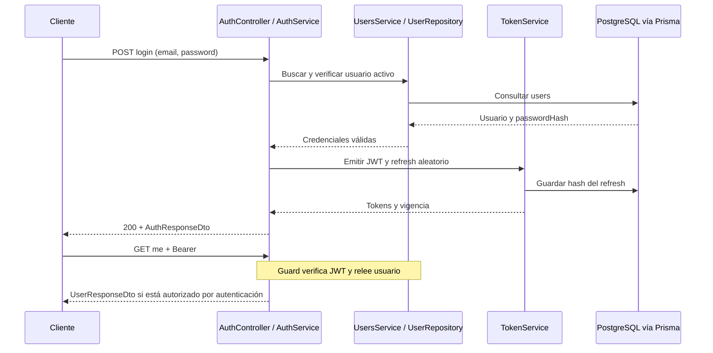

# Autenticación del backend

## Registro e inicio de sesión implementados

[UsersController](../src/users/controllers/users.controller.ts) abre `POST /api/v1/users` con `@Public()`. [CreateUserDto](../src/users/dto/create-user.dto.ts) exige email normalizado, contraseña string de 8 a 72 caracteres y al menos una minúscula, una mayúscula y un dígito. [IsNormalizedEmail](../src/common/decorators/is-normalized-email.decorator.ts) recorta, pasa a minúsculas, valida email y limita a 254 caracteres. El pipe transforma antes de validar; UserRepository normaliza otra vez para llamadas internas.

[UsersService](../src/users/services/users.service.ts) hashea con bcrypt y rondas de configuración, luego crea el usuario. El repositorio convierte P2002 en error de email ocupado y el service responde 409. [UserResponseDto](../src/users/dto/user-response.dto.ts) expone únicamente id, email, isActive y createdAt. Registro no entrega tokens: después se debe hacer login.

[AuthController](../src/auth/controllers/auth.controller.ts) acepta `POST /api/v1/auth/login`. LoginDto valida email y contraseña no vacía de hasta 72 caracteres, sin exigir la complejidad del registro. [AuthService](../src/auth/services/auth.service.ts) busca usuario, compara bcrypt y verifica isActive. Email inexistente, clave incorrecta y cuenta inactiva responden el mismo 401. Para email inexistente compara contra un hash dummy para reducir diferencias de tiempo; no hay medición que demuestre tiempos indistinguibles.

## Tokens y renovación

[AuthModule](../src/auth/auth.module.ts) configura JWT HS256 con secreto de entorno y vencimiento `JWT_EXPIRES_IN` (default 15m según [validateEnv](../src/config/env.validation.ts)). [TokenService](../src/auth/services/token.service.ts) firma payload `{ sub: user.id, email: user.email }`; no contiene rol. El refresh token son 32 bytes aleatorios codificados en hex; su SHA-256 se persiste con usuario y expiración (siete días por defecto).

Login y refresh devuelven [AuthResponseDto](../src/auth/dto/auth-response.dto.ts): accessToken, refreshToken, expiresIn en segundos y user público. El backend no crea cookies ni usa sesiones de Express.

`POST /auth/refresh` recibe refreshToken, busca su hash con usuario y rechaza inexistentes, vencidos o usuarios inactivos. Si el token está revocado, revoca todas las sesiones de ese usuario. Si es válido, revoca ese registro y emite un par nuevo. [RefreshTokenRepository](../src/auth/repositories/refresh-token.repository.ts) ofrece revocación por ID/hash, revocación global y borrado de expirados; no se encontró un scheduler que invoque la limpieza.

La lectura, revocación y creación no están dentro de una transacción ni usan una actualización condicional para reclamar el token. Dos renovaciones simultáneas podrían superar ambas la lectura de no revocado. La detección de reúso existe en el flujo secuencial, pero no garantiza exclusión bajo concurrencia. Es un riesgo inferido del código, no un fallo reproducido en esta revisión.

## Protección e identidad

[AppModule](../src/app.module.ts) registra `JwtAuthGuard` como APP_GUARD mediante `useExisting`. Para proteger una nueva ruta basta conservar el guard global y no marcarla pública. `@ApiBearerAuth()` documenta Swagger; por sí solo no protege rutas.

El [guard](../src/auth/guards/jwt-auth.guard.ts) lee Authorization, extrae Bearer, verifica JWT y consulta User por `sub`. Solo permite usuario existente y activo; lo adjunta a `request.user`. [CurrentUser](../src/auth/decorators/current-user.decorator.ts) extrae esa identidad en `/auth/me`. Cada petición protegida consulta la base aunque la firma JWT sea verificable sin ella. No se exige coincidencia entre email del token y el actual; la identidad de consulta es sub.

**No hay roles implementados.** Ni User, ni el payload, ni los DTOs contienen rol. No existen RolesGuard, decorador Roles, permisos por recurso ni comprobaciones de pertenencia a condominio/unidad. Residente, Administrador y Personal de seguridad son requisitos del Proyecto 1 del PDF, no roles disponibles actualmente.

## Cierre de sesión y límites

`POST /auth/logout` es público y requiere RefreshTokenDto. Revoca por hash de forma idempotente y responde 204 incluso si el token ya no existe o estaba revocado. Revocar refresh no invalida un access token vigente: puede seguir aceptándose hasta expirar si el usuario permanece activo. Desactivar o borrar User sí bloquea peticiones protegidas por la relectura del guard.

No hay recuperación de contraseña, verificación de email, MFA, bloqueo por intentos, rate limiting ni UI de administración de usuarios. La API de registro es pública; deberá discutirse cómo se vinculará un usuario a una unidad sin otorgarle permisos arbitrarios. El límite de 72 se mide en caracteres mediante MaxLength; no garantiza un límite de 72 bytes UTF-8 para bcrypt, pese al comentario del DTO.

## Secuencia actual

La secuencia no añade autorización por rol. Se conserva esta implementación íntegra durante la fase de análisis.
