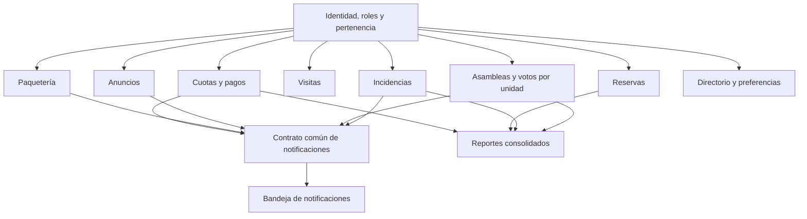

# Propuesta preliminar para la plataforma de condominios

## Alcance y procedencia

El Proyecto 1 de **Especificación de módulos y reglas del proyecto**, páginas 3-6, es la fuente de requisitos de negocio. Define Residente, Administrador y Personal de seguridad y diez módulos además de autenticación. El código actual solo aporta identidad y tokens; ver [resumen](00-resumen-ejecutivo.md). Esta propuesta no modifica código ni establece un schema definitivo.

El PDF plantea diez equipos con módulos asignados y cuatro semanas de trabajo. El encargo adjunto identifica un equipo de cinco personas y solicita visión global. Hasta confirmar la asignación, el orden y reparto siguientes son opciones de coordinación; no constituyen compromiso de implementar los diez módulos ni un calendario acordado.

## Requerimientos del Proyecto 1

La siguiente tabla resume las necesidades y casos de uso del PDF con palabras propias. Las tecnologías, entidades y dependencias propuestas después no forman parte de esta tabla de requisitos.

| Módulo | Necesidad / principales usos | Criterio de éxito del documento, resumido |
|---|---|---|
| 0. Autenticación y roles | Acceso según tipo de usuario; aprovechar base de cátedra y justificar decisiones frontend | Separar lo que cada tipo puede ver/hacer; el código todavía carece de roles |
| 1. Cuotas y pagos de mantenimiento | Residente consulta estado y paga pendientes; administración identifica morosidad y genera cuotas mensuales sin repetir unidad por unidad | Visibilidad de salud financiera y deudas |
| 2. Reservas de áreas comunes | Consultar disponibilidad, reservar sin cruces y administrar áreas, capacidad y horarios | Ningún espacio queda reservado por dos residentes a la misma hora |
| 3. Incidencias y mantenimiento | Reportar con fotos/descripción, consultar estado, priorizar/asignar y dar seguimiento a resolución | Reportes trazables con estado visible |
| 4. Acceso de visitas | Preautorizar; seguridad registra entrada/salida, autorizada o no, y consulta visitas presentes | Saber quién está dentro y motivo sin depender de papel |
| 5. Paquetería | Seguridad registra llegada por unidad; residente recibe aviso y consulta historial y pendientes | Evitar pérdidas y entrega a persona equivocada |
| 6. Asambleas y votaciones digitales | Convocar con agenda, votar y consultar resultados auditables | Una sola votación por unidad y tema |
| 7. Anuncios y comunicados | Publicar para todos o torre/sección; mostrar al residente lo que le corresponde | Avisos oficiales relevantes llegan a su audiencia |
| 8. Directorio de residentes | Decidir aparición y datos compartidos; buscar contactos permitidos | No exponer datos que alguien decidió no compartir |
| 9. Notificaciones | Concentrar avisos de cuotas, paquetes, comunicados y otros; ofrecer envío a usuario/grupo a los demás módulos | Un único lugar para avisos y lógica compartida de notificación |
| 10. Reportes financieros y analíticos | Consolidar morosidad, uso de áreas, incidencias y participación; compartir con mesa o asamblea | Decisiones sustentadas en datos de otros módulos |

Los criterios de negocio deben concretarse en casos comprobables con la cátedra. Por ejemplo, la frase sobre enterarse de anuncios requiere definir evidencia de publicación/lectura; no se asume una garantía absoluta de que cada persona haya leído un comunicado.

## Dependencias propuestas

Los módulos necesitan identificar actores y destinatarios. Se propone acordar primero el significado de condominio, torre/sección, unidad y pertenencia de usuario. El directorio no debe convertirse en el dueño de la identidad: su visibilidad es opcional, pero la pertenencia operativa no debería depender de aparecer en él.

Las flechas representan dependencias lógicas propuestas, no imports existentes. El PDF destaca notificaciones como servicio interno transversal y reportes como agregador tardío; las conexiones concretas deben acordarse. Visitas y reservas podrían generar avisos si el alcance lo requiere, sin asumirlo como requisito adicional.

## Conceptos compartidos por discutir

| Concepto candidato | Uso esperado | Decisión abierta |
|---|---|---|
| User existente | Identidad y credenciales | Cómo asignar roles y estado; qué datos públicos exponer |
| RefreshToken existente | Continuidad de sesión | Renovación, revocación y concurrencia |
| Condominio, torre/sección, unidad | Alcance, destinatarios, cuotas y votación | Uno o varios condominios, identificadores y cardinalidades |
| Pertenencia / representación de unidad | Enlazar usuario con contexto de negocio | Múltiples residentes, responsables, cambios históricos y facultad de voto |
| Preferencias y visibilidad | Directorio y comunicaciones | Opt-in y campos visibles; quién consulta cada dato |
| Notificación y destinatario | Bandeja común | Persistencia, lectura, reintentos y contrato de productores |
| Registro de cambios / evidencia | Finanzas, incidencias, accesos, paquetes y votación | Retención, actor, eventos relevantes y acceso a evidencia |

Cuota, pago, área, reserva, incidencia, visita, paquete, asamblea, tema y voto son conceptos de sus respectivos dominios, aún sin modelos. No se fijan aquí campos, FK ni nombres Prisma. Evitar que cada módulo cree su propia tabla de usuarios o invente un significado distinto de unidad.

## Orden recomendado de implementación futura

1. **Confirmar alcance y contratos:** módulo asignado, roles, pertenencia, errores, identificación y dueño de cada entidad compartida. Registrar decisiones.
2. **Cerrar un flujo vertical de autenticación:** puertos y URL, login, consulta del usuario, expiración/renovación y logout. El backend existente es reutilizable, con los riesgos descritos en [autenticación](04-autenticacion-backend.md).
3. **Acordar la interfaz de notificaciones pronto:** destinatarios y evento mínimo antes de desarrollar sus productores. No obliga a construir todos los canales desde el inicio.
4. **Implementar el módulo asignado:** una operación completa backend/base/frontend, con permisos, validaciones y criterios del PDF. Si el equipo coordina varios módulos, distribuirlos solo después de estabilizar los conceptos compartidos.
5. **Integrar módulos y reportes:** reportes después de disponer de datos y definiciones de saldos, ocupación e incidencias; verificar consistencia y autorización.
6. **Preparar entrega académica:** revisión cruzada, README con nombres y roles confirmados, documentación de arquitectura, historial/PR internos y demo accesible a cátedra.

No se requiere empezar por cuotas si el equipo recibe otro módulo. Tampoco se presupone cambiar ORM, adoptar Redux/Zustand, microservicios, una pasarela de pagos o eventos externos.

## Organización sugerida para cinco desarrolladores

| Integrante | Responsabilidad primaria propuesta | Revisión cruzada sugerida |
|---|---|---|
| Armando | Coordinación de contratos, integración y Git | Revisar API con Heber y despliegue con Yael |
| Heber | Backend del módulo asignado y autorización | Revisar cambios de datos con Guille |
| Guille | Modelo de datos, migraciones y consistencia | Revisar contratos e invariantes con Heber |
| Serrato | Frontend, formularios y experiencia de sesión | Revisar flujo completo con Armando |
| Yael | QA, documentación y entorno/demo | Verificar criterios de aceptación con Serrato |

Son responsabilidades propuestas, no una asignación aprobada ni afirmación de contribuciones realizadas. Cada tarea debería tener una segunda persona revisora y evidencia en PR internos; todos pueden contribuir al flujo completo. Los apellidos y cuentas GitHub de los otros integrantes no se conocen y no se inventan ni se envían invitaciones.

## Riesgos de integración y agenda inicial

Resolver primero diferencias de URL y puertos, ausencia de roles y vínculo usuario/unidad, renovación de sesión y propiedad de migraciones. Después, acordar idempotencia de pagos/notificaciones, concurrencia de reservas y votos, estados de procesos, zona horaria, privacidad y definición de métricas. Estos son riesgos derivados de las necesidades del PDF, no funcionalidades del código actual.

La primera reunión debe terminar con alcance asignado confirmado, matriz preliminar de permisos, contratos compartidos con responsables, elección razonada de sesión/estado frontend, criterios de aceptación y tareas pequeñas revisables. Registrar las preguntas pendientes para la cátedra; no tratar respuestas supuestas como requisitos obligatorios.
