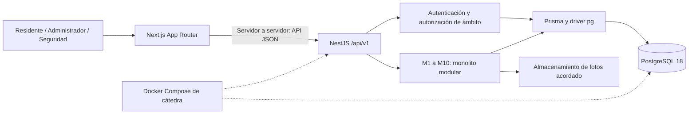
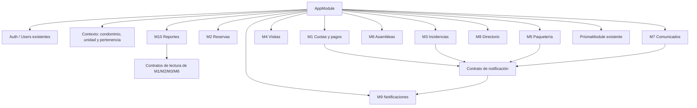
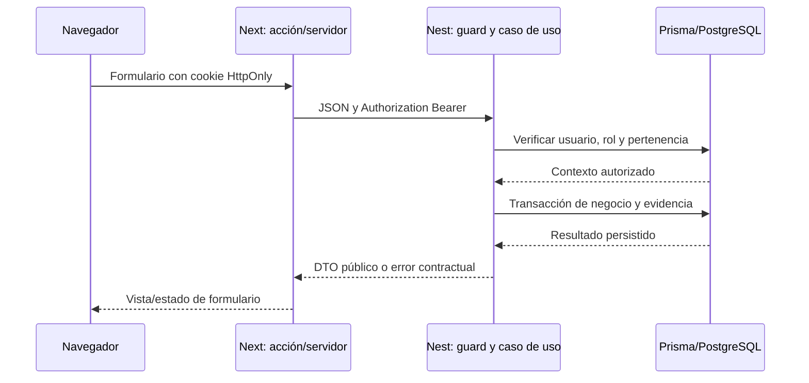

# Arquitectura propuesta de la plataforma

> Edición para revisión en el fork, publicada por solicitud posterior del equipo. La arquitectura, estimaciones y asignaciones siguen siendo propuestas. Las referencias a conservación local, ausencia de commits/push y «esta ejecución» describen la etapa de planificación anterior; esta publicación posterior incorpora la documentación sin modificar aplicación ni protecciones.

**Estado:** planificación propuesta, no implementación ni decisiones aprobadas. **Alcance confirmado por el equipo:** diez módulos más adaptación de autenticación; cinco integrantes; cuatro semanas.

## Base técnica y diferencias con la propuesta

**HV:** NestJS 12/TypeScript 6, Prisma 7/PostgreSQL 18, Next.js 16.3.6/React 19.2.8/Tailwind 4. Registro/JWT/refresh existen; roles, pertenencia y negocio no. Login Next es real pero su cookie dura siete días, no renueva access token (15m por defecto) ni revoca refresh al salir. Las plantillas de puertos/prefijo no coinciden. Evidencia detallada: [guía técnica](guia-tecnica-y-backlog-condominios.md), secciones 2–10; no se repite la inspección de código.

**PA recomendada:** conservar estas tecnologías y un monolito modular con los diez módulos de negocio, identidad/contexto compartidos y una base PostgreSQL común. El menor número de despliegues y contratos de red permite concentrar esfuerzo en las reglas obligatorias. No se justifica migrar ORM/framework ni introducir microservicios en este horizonte.

## 1. Arquitectura general propuesta

Next no está en el Compose actual. Integrarlo al despliegue será una decisión futura, conservando el Compose entregado. El almacenamiento de archivos y los módulos de negocio del diagrama son propuestas, no componentes ya operativos.

## 2. Organización modular de backend

Cada módulo puede conservar `controllers/`, `dto/`, `services/`, `repositories/` y tipos públicos necesarios. Exportar servicios/contratos mínimos; no importar repositorios internos de otro dominio. Los contratos pueden ser interfaces TypeScript y providers de Nest acordados, sin broker ni librería nueva. Reportes puede consumir consultas de lectura especializadas de cada productor o vistas acordadas; no reescribir estados/saldos por cuenta propia.

| Componente | Responsabilidad PA | Límite |
|---|---|---|
| Controller | Método/ruta, DTO, actor autenticado y respuesta | No implementar cálculos ni acceso directo a Prisma |
| Service/caso de uso | Reglas, permisos de recurso, transiciones y coordinación de transacción | No depender de UI o detalles internos de otro módulo |
| Repository | Consultas, inserciones, restricciones y traducción de errores de persistencia | No elegir quién tiene permiso a partir de parámetros del cliente |
| DTO | Contrato de entrada/salida, validación y mapeo explícito | No devolver fila cruda con datos sensibles |
| Guard | Sesión, rol y contexto inicial | Autorización por recurso también en caso de uso cuando necesita consultar propiedad |
| Servicio compartido | Identidad/contexto, archivos y notificación mediante contrato | No concentrar reglas específicas de todos los módulos en common |

Validación en borde con class-validator/class-transformer ya presentes; integridad de datos en base y reglas semánticas en service. Definir catálogo de errores con 400/401/403/404/409 según caso y sin exponer secretos; evitar revelar existencia de recursos ajenos. Es una propuesta de contrato, no un filter ya implementado. Mantener el mapeo explícito de salida y normalización de email.

**Autorización propuesta:** asignación de rol por condominio y pertenencia usuario-unidad N:M; no aceptar un rol o condominio enviado en formulario como prueba de permiso. Residente, administrador y seguridad pueden coexistir en ámbitos distintos si D-02 lo aprueba. La navegación solo orienta, la API deniega.

**Transacciones:** coordinar desde service/caso de uso con cliente transaccional compartido por repositorios participantes. Voto único requiere unicidad unidad+tema; reservas de intervalos requieren mecanismo real de exclusión (restricción de rangos o aislamiento/bloqueo explícito por área, por decidir), no solo consulta previa. Pagos/cuotas requieren claves idempotentes y registro consistente de aplicaciones/historial. Refresh requiere consumo condicional atómico y tratamiento de concurrencia. No se genera SQL ni migración con este plan.

**Notificaciones:** construir primero contrato y persistencia M9; integrar productores al completar sus historias. Proponer guardar intención de notificación junto a operación y procesarla con reintentos idempotentes si D-11 exige sobrevivir fallos; no afirmar que un evento en memoria garantiza entrega. Elegir la mínima fiabilidad aceptada sin introducir infraestructura externa por defecto.

## 3. Frontend propuesto

App Router con páginas por función, layouts de navegación y componentes de formularios/listas reutilizables. Rutas candidatas, no creadas: `/cuotas`, `/reservas`, `/incidencias`, `/visitas`, `/paqueteria`, `/asambleas`, `/comunicados`, `/directorio`, `/notificaciones`, `/reportes`. Vistas administrativas y de seguridad se autorizan por operación; el nombre de ruta no concede permiso.

Conservar componentes de servidor para lectura donde convenga y componentes cliente para interacción. Server Actions actúan como frontera de formularios y llaman al cliente API de servidor; no duplican las reglas Nest. Un módulo `lib/api` propuesto centraliza base URL, Bearer, errores y tratamiento de 401/refresh; `lib/session` conserva responsabilidad de sesión. Componentes de dominio pueden agruparse junto a su ruta, extraer `features` solo si ayuda a evitar duplicación.

Empezar con estado local y useActionState ya disponible. Compartir identidad de presentación solo cuando haga falta; no añadir Redux/Zustand sin necesidad concreta. Formularios deben presentar errores de campo, error global, estado vacío/cargando, confirmación y protección contra doble envío como ayuda de UI; el control de duplicados real permanece en API/base.

**SP D-13:** estrategia exacta de refresh: cookie HttpOnly con protección y duración coherentes o sesión de servidor con identificador opaco; la segunda requiere persistencia adicional. Coordinar renovación entre solicitudes/pestañas, no reutilizar simultáneamente un refresh de un solo uso; limpiar sesión ante rechazo definitivo y distinguir fallo temporal de red. Logout revoca refresh y borra cookie con política explícita si API falla. No compartir JWT_SECRET con el navegador; consultar `/auth/me` para identidad. Revisar controles de solicitudes modificadoras de estado y origen en Next además de SameSite.

## 4. Integración Next–Nest–PostgreSQL propuesta

PA inicial de entorno: API en host 3000, Next en 3001 y `API_URL=http://localhost:3000/api/v1` para Next ejecutado en host. Si Next corre en contenedor, usar nombre de servicio/red compatible; localhost no es la API de otro contenedor. No cambiar plantillas ahora. Login actual es servidor-servidor y no requiere CORS del navegador; si se decide fetch directo desde navegador hay que definir CORS/credenciales expresamente.

## Decisiones y límites

Dependencias entre módulos: [04-dependencias-modulos.md](04-dependencias-modulos.md). Entidades y cardinalidades: [03-modelo-datos-conceptual.md](03-modelo-datos-conceptual.md). Los contratos API finales, endpoints nuevos, esquema Prisma y políticas de estado siguen pendientes de revisión. No se añade librería, tabla, ruta o infraestructura con esta documentación.
