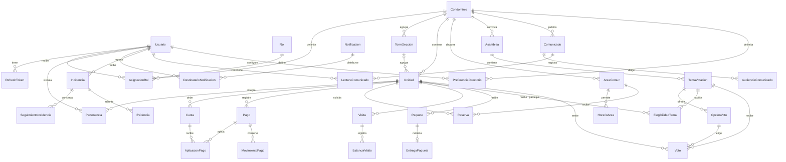

# Modelo de datos conceptual compartido

> Edición para revisión en el fork, publicada por solicitud posterior del equipo. La arquitectura, estimaciones y asignaciones siguen siendo propuestas. Las referencias a conservación local, ausencia de commits/push y «esta ejecución» describen la etapa de planificación anterior; esta publicación posterior incorpora la documentación sin modificar aplicación ni protecciones.

**Estado:** planificación propuesta, no implementación ni decisiones aprobadas. **Alcance confirmado por el equipo:** diez módulos más adaptación de autenticación; cinco integrantes; cuatro semanas.

## Naturaleza del modelo

**PA conceptual para discutir**, no schema Prisma final. Solo Usuario y RefreshToken existen en el código analizado; el resto son conceptos candidatos. Los atributos no fijan tipos, endpoints ni migraciones. Se considera condominio como ámbito de autorización; una UI multi-condominio completa no se presume necesaria (D-02).

## Entidades, relaciones y responsables

Las cardinalidades indican la propuesta candidata y deben revisarse con D-02..D-13. Dueño lógico significa módulo que valida modificaciones, no persona exclusiva ni permiso directo de escribir tablas ajenas.

| Entidad | Finalidad / atributos candidatos | Relaciones y cardinalidades | Restricciones importantes | Uso | Dueño lógico | Decisión pendiente |
|---|---|---|---|---|---|---|
| Usuario | Identidad existente; id/email/passwordHash/isActive y fechas; contacto candidato separado de credencial | Usuario 1:N AsignaciónRol y Pertenencia; 1:N RefreshToken | Email único y normalizado; nunca exponer hash | Todos | Users/Auth; no módulos consumidores | Datos de contacto y proceso de alta D-02/D-10 |
| RefreshToken | Sesión existente; hash, usuario, expiración/revocación | Usuario 1:N tokens | Hash único; consumo/revocación coherentes | M0 | Auth | Rotación concurrente y retención D-13 |
| Rol | Catálogo candidato; código/nombre | Rol 1:N AsignaciónRol | Tres roles del PDF; no otorgar desde cliente | Todos | Autorización | Catálogo fijo o configurable D-02 |
| AsignaciónRol | Ámbito del permiso; usuario, rol, condominio, vigencia | Usuario/Rol/Condominio cada uno 1:N asignaciones | Una asignación vigente equivalente por combinación; revocación controlada | Todos | Autorización | Varios roles por usuario/condominio D-02 |
| Condominio | Contexto; id, nombre y zona horaria candidata | Condominio 1:N torres y unidades; 1:N asignaciones | No mezclar datos entre ámbitos | Todos | Contexto de comunidad | UI multi-condominio o un condominio inicial D-02 |
| TorreSección | Agrupación para audiencias; id/nombre/condominio | Condominio 1:N torres; Torre 1:N unidades | Torre pertenece a un condominio; unidad solo referencia torre de su ámbito | M1/7/10 y contexto | Contexto | Torre opcional en unidades sin torre D-02 |
| Unidad | Entidad habitacional; id/código/condominio/torre opcional | Condominio 1:N unidades; Unidad 1:N pertenencias | Código único dentro del condominio; no equivale a usuario | Todos | Contexto | Bajas y cambios de numeración D-02 |
| Pertenencia | Vínculo usuario-unidad; rol residencial candidato, vigencia, facultad de representación | Usuario N:M Unidad mediante Pertenencia | Varios residentes por unidad y varias unidades por usuario; vigencia y mismo ámbito | Todos; M6 crítico | Contexto con autorización | Historial, representante y traslado D-02/D-08 |
| Notificación | Evento/contenido, tipo, origen/referencia, fecha, clave de evento | Notificación 1:N DestinatarioNotificación | Origen autorizado; referencia no concede permiso | M1/3/5/6/7/9 | M9 vía contrato | Intención durable, retención y contenido D-11 |
| DestinatarioNotificación | Entrega individual; notificación, usuario, ámbito, leídaEn | Usuario N:M Notificación mediante destinatario | Único evento+destinatario según contrato; no consultar ajenos | M9 y productores | M9 | Grupos resueltos al emitir o dinámicos D-11 |
| Cuota | Cargo por unidad y periodo; importe, moneda, vencimiento, regla/periodo | Unidad 1:N cuotas; cuota 1:N aplicaciones de pago | Idempotencia unidad+periodo+concepto aprobado; decimal | M1/M10 | M1 | Cuotas extraordinarias/recargos D-03 |
| Pago | Operación de pago; referencia, unidad, importe/moneda, medio, estado/confirmación y actor | Unidad 1:N pagos; Pago 1:N aplicaciones y movimientos | Referencia idempotente; no borrar evidencia financiera; transición válida | M1/M10 | M1 | Proveedor/medio, parciales y anulaciones D-03 |
| AplicaciónPago | Distribuye pago confirmado a cuota; importe aplicado | Pago N:M Cuota mediante aplicación | Suma aplicada no excede pago; saldo no negativo salvo política expresa | M1/M10 | M1 | Un pago puede cubrir varias cuotas D-03 |
| MovimientoPago | Evidencia de cambio de pago; estado/actor/fecha/referencia | Pago 1:N movimientos | Historial preservado y corrección trazable, sin reescritura silenciosa | M1 | M1 | Qué datos de confirmación conservar D-03 |
| ÁreaComún | Espacio; nombre/capacidad/condominio/activo | Área 1:N horarios y reservas | Capacidad positiva y ámbito consistente | M2/M10 | M2 | Cierre temporal y reglas D-04 |
| HorarioÁrea | Ventana permitida; día/hora inicio/fin/vigencia | Área 1:N horarios | Ventanas válidas y zona horaria acordada | M2 | M2 | Excepciones de calendario D-04 |
| Reserva | Intervalo; área/unidad/actor/inicio/fin/asistentes/estado | Área y Unidad 1:N reservas | Exclusión de intervalos activos por área; no solo unicidad inicio; capacidad | M2/M10 | M2 | Estados que ocupan espacio, cancelación D-04 |
| Incidencia | Reporte; autor/ámbito/unidad opcional/descripción/estado/prioridad/asignado | Incidencia 1:N seguimientos y evidencias | Autoría/estado visibles y autorización de lectura | M3/M10 | M3 | Asignables/estados D-05 |
| SeguimientoIncidencia | Cambio/comentario; incidencia/actor/fecha/estado previo/nuevo | Incidencia 1:N seguimiento | Orden y transiciones coherentes; no pérdida de trazabilidad | M3 | M3 | Qué cambios ve residente D-05 |
| Evidencia | Archivo/foto; referencia de almacenamiento, tipo/tamaño/autor/recurso | Incidencia 1:N evidencias en alcance mínimo | Descarga autorizada; no URL pública permanente por defecto | M3; otros solo si se aprueba | Contrato archivos y dueño del recurso | Almacenamiento, límites y retención D-05 |
| Visita | Plan/identidad mínima; anfitrión/unidad/fecha prevista/autorización | Unidad 1:N visitas; Visita 1:N estancias | Puede registrarse visita sin preautorización; no perder propósito | M4 | M4 | Identidad/validez/retención D-06 |
| EstanciaVisita | Ingreso/egreso; visita/entrada/salida nullable/actor/motivo | Visita 1:N estancias | A lo sumo estancia abierta por visita según regla; salida posterior | M4 | M4 | Reingresos y correcciones D-06 |
| Paquete | Recepción; unidad/referencia/fecha/actor/estado | Unidad 1:N paquetes; Paquete 0:1 entrega efectiva propuesta | Pendiente/entregado consistente; referencia y evidencia | M5 | M5 | Unicidad de referencia y devoluciones D-07 |
| EntregaPaquete | Retiro; paquete/receptor/autoridad verificada/actor/fecha | Paquete 0:1 entrega; receptor usuario o delegado por definir | Única entrega efectiva; validación de receptor autorizada | M5 | M5 | Delegado/evidencia mínima D-07 |
| Asamblea | Convocatoria; condominio/título/fecha/agenda/estado | Asamblea 1:N temas | Audiencia y facultad de convocar | M6/M10 | M6 | Ventanas, convocados y quorum D-08 |
| TemaVotación | Tema/pregunta; asamblea/ventana/opciones/estado | Tema 1:N opciones y votos; relación con elegibilidad | Apertura/cierre consistentes, no voto en tema cerrado | M6/M10 | M6 | Quorum/empate y cierre D-08 |
| OpciónVoto | Alternativa; tema/etiqueta/orden | Tema 1:N opciones; opción 1:N votos | Opción pertenece al tema del voto | M6 | M6 | Sí/no, múltiple o abstención D-08 |
| ElegibilidadTema | Foto candidata de unidades habilitadas; tema/unidad | Tema N:M Unidad mediante elegibilidad | Evitar variar denominador al cambiar pertenencias; acceso por representante autorizado | M6/M10 | M6 con contexto | Elegibilidad a apertura o dinámica D-08 |
| Voto | Decisión de unidad; tema/unidad/opción/fecha/evidencia de actor restringida | Tema/Unidad 1:N votos; unidad+tema a lo sumo uno | Único unidad+tema aun si cambia usuario; atomicidad; auditabilidad | M6/M10 | M6 | Privacidad e inmutabilidad concreta D-08 |
| Comunicado | Publicación; contenido/autor/condominio/fecha/estado | Comunicado 1:N audiencias y lecturas | Autor autorizado y contenido disponible solo a audiencia | M7/M9 | M7 | Edición y evidencia D-09 |
| AudienciaComunicado | Destinatario lógico; comunicado/alcance/torre o unidad candidata | Comunicado N:M grupo/unidad según modelo aprobado | Torre/unidad del mismo ámbito; todo-condominio explícito | M7 | M7 con contexto | Foto al publicar o audiencia dinámica D-09 |
| LecturaComunicado | Acuse candidato; comunicado/usuario/fecha | Usuario N:M Comunicado mediante lectura | No prueba lectura humana; no divulgar a terceros sin permiso | M7 | M7 | Si cátedra exige acuse y qué demuestra D-09 |
| PreferenciaDirectorio | Visibilidad; usuario/condominio/opt-in/campos permitidos | Usuario y Condominio 1:N preferencias; combinación única | No filtrar datos no consentidos; invalidar caché al ocultar | M8 | M8; credencial sigue en Users | Visibilidad con varias unidades D-10 |
| ReporteDerivado | Consulta/DTO calculado; ámbito/periodo/corte/métricas/fuentes | Lee M1/M2/M3/M6; no tabla obligatoria | Misma fórmula y corte, cero distinto de fallo, permisos | M10 | M10 por contratos de lectura | Fórmulas/denominadores D-12 |
| ReporteCompartido | Captura opcional; corte/contenido autorizado/audiencia/autor | 0:N capturas por consulta; audiencia según medio elegido | No crear una segunda fuente financiera; compartir no elude permisos | M10 | M10 | Puede ser impresión/exportación sin tabla D-12 |

## Diagrama ER conceptual

ReporteDerivado es una vista conceptual de lectura, no entidad persistente del ER. ReporteCompartido solo necesitaría tabla si el medio de compartir aprobado requiere capturas persistidas; imprimir/exportar puede evitarla. No todos los atributos/FK de la tabla se dibujan para mantener legibilidad.

## Invariantes a aprobar y probar

1. **Usuario y unidad son distintos:** dos usuarios pueden vivir en la misma unidad; un usuario puede relacionarse con varias. Pertenencia conserva vigencia; votar exige seleccionar unidad habilitada y facultad de representación.
2. **Ámbito:** una asignación administrativa en A no administra B; seguridad no hereda finanzas. Referencias a torre/unidad/área no cruzan condominios sin política explícita.
3. **Voto:** unicidad de unidad+tema en base, comprobación de opción del tema y representación en transacción. La facultad no puede depender solo de un radio button de frontend.
4. **Reserva:** exclusión de intervalos activos por área, horarios y capacidad; un índice único inicio no impide solapamientos de intervalos distintos. Definir [inicio, fin) y tratamiento de reservas colindantes en D-04.
5. **Pagos:** decimales exactos, moneda, referencia idempotente y aplicación en transacción; historial y corrección auditables. Confirmación del medio de pago no se deduce de subir una foto.
6. **Directorio:** opt-in y visibilidad por campo en consulta/detalle; ocultación invalida caché. La pertenencia operativa no desaparece por salir del directorio.
7. **Paquetes y visitas:** estados e identidad permiten reconstruir recepción/entrega y estancia; retención y minimización se acuerdan en D-06/07.

Antes de implementar cada entidad, revisar su dueño, cardinalidades y datos mínimos con RF, contratos y escenarios de prueba. No se crea tabla por cada sustantivo de esta propuesta si una estructura menor satisface la misma regla y se documenta.
