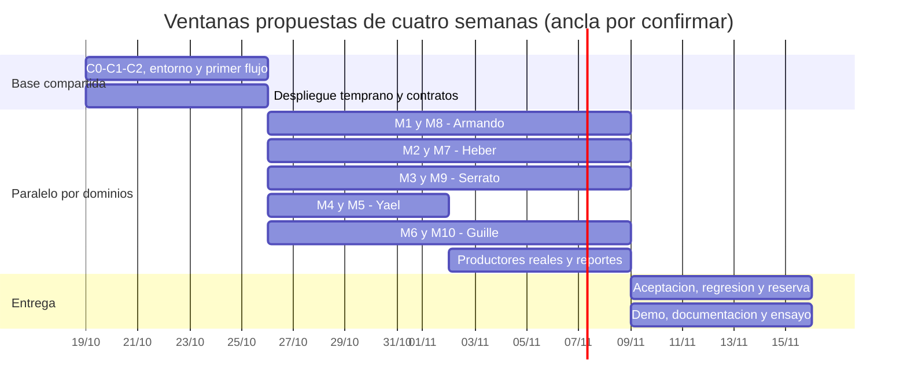

# Cronograma de cuatro semanas y análisis de viabilidad

> Edición para revisión en el fork, publicada por solicitud posterior del equipo. La arquitectura, estimaciones y asignaciones siguen siendo propuestas. Las referencias a conservación local, ausencia de commits/push y «esta ejecución» describen la etapa de planificación anterior; esta publicación posterior incorpora la documentación sin modificar aplicación ni protecciones.

**Estado:** planificación propuesta, no implementación ni decisiones aprobadas. **Alcance confirmado por el equipo:** diez módulos más adaptación de autenticación; cinco integrantes; cuatro semanas.

## Evaluación de viabilidad antes de fijar fechas

Backlog esencial: **392 h-persona** (92 compartidas + 250 dominio + 50 aceptación global/cierre). Reserva de incertidumbre 25%: **98 h**; referencia **490 h efectivas**. Las estimaciones incluyen pruebas locales e integración de historia; cierre agrega aceptación conjunta y regresión. La reserva absorbe defectos/desvíos; no compra mejoras opcionales.

No se conoce disponibilidad. Se descuenta 25% de horas disponibles para reuniones, coordinación y contexto; ese descuento es distinto de la reserva de esfuerzo por incertidumbre. Ambos son supuestos PA, no métricas observadas.

| Disponibilidad por persona/semana | Capacidad bruta 5×4 | Efectiva al 75% | Margen frente a 490 h | Lectura |
|---|---|---|---|---|
| 20 h | 400 | 300.0 | -190.0 | No cabe sin intervención |
| 25 h | 500 | 375.0 | -115.0 | Sobrecarga importante |
| 35 h | 700 | 525.0 | 35.0 | Viable solo bajo supuestos favorables; margen reducido |
| 45 h | 900 | 675.0 | 185.0 | Mayor margen, disponibilidad académica no confirmada |

**Conclusión:** completar los diez módulos es posible como MVP académico sencillo si hay aproximadamente 33 h disponibles por persona/semana al 75% efectivo y se cumplen supuestos de base. A 35 h el margen total es 35 h; no es garantía. A 25 h falta 115 h efectivas y no debe aprobarse el cronograma sin ajustes. La fórmula de umbral es 490/(5×4×0,75)=32,67 h/persona/semana.

La referencia supone medio de pago aceptado sin una integración compleja no prevista, entrega de paquetes con evidencia sencilla aprobada, reportes compartidos mediante salida simple autorizada, sin hardware de acceso ni email/SMS obligatorio, experiencia suficiente y contratos resueltos temprano. Si cátedra exige un proveedor específico, mayor auditoría o una UX avanzada, reestimar las historias afectadas; no esconderlo en la reserva. El rango 0,75–1,5× del backlog base alcanza 294–588 h antes de una reserva recalibrada: es incertidumbre, no compromiso.

## Distribución semanal por historias

Cada historia HU del backlog tiene semana objetivo de terminación. Su diseño puede comenzar antes. Las horas siguientes agrupan la cifra completa en su semana objetivo como comprobación conservadora de capacidad, sin sumar sub-tareas otra vez.

| Semana | Historias base / h | Reserva | Carga efectiva planificada | Capacidad al escenario 35 h |
|---|---|---|---|---|
| S1 | 110 | 15 | 125 | 131.25 |
| S2 | 104 | 20 | 124 | 131.25 |
| S3 | 128 | 0 | 128 | 131.25 |
| S4 | 50 | 63 | 113 | 131.25 |

Se desplazaron pago/generación mensual (HU-01-002/004), reserva excluyente (HU-02-002) y asignación de incidencias (HU-03-002) a salida S3 para que S2 no concentre todo el esfuerzo. Sus contratos y avances se trabajan desde S1/S2. M4 preautorización (HU-04-001) y contrato persistido M9 (HU-09-002) son candidatos de primer flujo S1.

La reserva de 63 h en S4 es un colchón explícito de defectos/deslizamientos, no desarrollo de casos nuevos planificado para el último momento. S3 tiene 128 h base y solo 3,25 h de margen al escenario de capacidad: no se le asigna reserva local; anticipar trabajo desde S2 y tratar esto como riesgo de ruta crítica. Si S1/S2 consumen su reserva y amenazan S3, replanificar al detectar el desvío; no esperar a la presentación.

## Semana 1 — Base y primer recorrido

- **Objetivos:** alcance completo compartido, entorno compatible, roles/contexto, sesión, contratos y primer flujo real.
- **Actividades:** HU-T-01..08; HU-09-002; HU-04-001. Cada dueño diseña contratos de sus dos dominios con C0/C1/C2; revisar D-01..D-14 prioritarias.
- **Dependencias:** disponibilidad de herramientas, acuerdo de pertenencia, decisiones de sesión, acceso a un entorno de demo. No alterar la base sin revisión previa.
- **Responsables propuestos:** Heber entorno/contratos; Guille contexto; Serrato/Heber sesión y contrato M9; Yael autorización/primer acceso; Armando coordinación y apoyo a contexto.
- **Entregables:** contratos revisados, datos de desarrollo N:M, login/me/renovación/logout probado, preautorización persistida de visita con permiso y servicio M9 invocable por contrato.
- **Salida:** primer recorrido Next→Nest→PostgreSQL y PR-T relevantes demostrados; no confundir hook/contrato con módulo M9 completo. Si no sale, registrar bloqueo y reestimar antes de comprometer S2.
- **Riesgos:** base más grande de lo previsto, herramientas ausentes, sesión/roles tardíos y cuello de migraciones.

## Semana 2 — Desarrollo paralelo y primeras funciones completas

- **Objetivos:** cinco frentes con UI/API/datos y pruebas; primera integración entre productores y bandeja, sin esperar al cierre.
- **Actividades:** historias con objetivo S2: estado/mora M1; consulta/configuración M2; reporte con evidencia M3; ingreso/salida/presentes M4; recepción/historial/entrega M5; M7/M8. Adelantar interfaz/bandeja HU-09-001, cuya aceptación y esfuerzo conservador se sitúan en S3 junto a productores. Preparar contratos y prototipos de M6/M10.
- **Dependencias:** C0/C1/C2, C3 para fotos y HU-09-002 para avisos. Recordar que HU-09-001 aún necesita productores reales para su aceptación completa; anticipar integración de eventos disponibles, no aceptar fixtures como final.
- **Responsables:** los cinco dueños verticales y sus revisores; Guille inicia asambleas/modelo de métricas mientras apoya revisión de datos.
- **Entregables:** recorridos reales de módulos tempranos, errores y permisos; comunicado y recepción de paquete ya pueden alimentar bandeja; plan de pago/periodicidad listo para completar S3.
- **Salida:** historias con objetivo S2 verificadas; HU-09-001 se considera parcialmente construida hasta conectar cuota por vencer y los otros productores reales en S3. Registrar esfuerzo real adelantado sin sumarlo dos veces al esfuerzo de su historia.
- **Riesgos:** dueño ocupado en base, validación solo visual, archivos no compatibles con despliegue y reporte de avance por capa en lugar de flujo.

## Semana 3 — Alcance completo e integración de reportes

- **Objetivos:** cubrir todos los RF y sus integraciones reales; cerrar funciones transaccionales y dependencias tardías.
- **Actividades:** HU-01-002/004, HU-02-002, HU-03-002/003, HU-05-002, HU-06-001..003, HU-10-001..003. Completar productor de cuota próxima a vencer, avisos/seguimiento y aceptación final de HU-09-001; comprobar PR-S críticos temprano.
- **Dependencias:** decisiones D-03/04/08/12, notificaciones de M9 y fuentes reales M1/M2/M3/M6; definir denominadores y corte de reportes con cada productor.
- **Responsables:** dueños de módulos con apoyo cruzado, especialmente Guille en M6/M10 y Armando en pagos. Revisor reproduce voto/reserva/pago sin duplicados.
- **Entregables:** los diez módulos con MVP obligatorio demostrable, incluyendo compartir reportes, evidencia de comunicación, periodicidad y entrega de paquetes; reporte de fallos pendiente por gravedad.
- **Salida:** ningún caso oficial se etiqueta opcional o queda sustituido por datos simulados. Todos los RF tienen recorrido y evidencia inicial; casos críticos fallidos pasan a corrección prioritaria, no a aceptación ficticia.
- **Riesgos:** transacciones, mecanismo de pago, reportes sin fuentes y falta de revisión de privacidad; usar reserva/redistribución antes de quitar requisitos.

## Semana 4 — Aceptación, estabilización y entrega

- **Objetivos:** corregir, desplegar, probar, documentar y ensayar el conjunto ya integrado.
- **Actividades:** HU-E-01..04; regresión funcional, concurrencia y aislamiento, verificación demo/actualización; resolver deuda crítica con la reserva.
- **Dependencias:** cobertura inicial de S3, entorno demo temprano y contratos estables.
- **Responsables:** todos ejecutan y revisan módulos; Yael consolida matriz, Armando documentación, Heber/Yael despliegue con apoyo de dueños. Ninguno monopoliza pruebas o integración.
- **Entregables:** demo accesible, evidencias PR/RF/CA, README con contribuciones y enlaces, decisiones y presentación por los cinco.
- **Salida:** 29 RF y criterios aceptados, pruebas críticas aprobadas, cambios revisados, sin datos sensibles en documentación; entrega por forks/demo como exige PDF.
- **Riesgos:** hosting, defectos tardíos y falta de evidencia; S4 no recupera mágicamente módulos no iniciados.

## Gantt ilustrativo, no fechas aprobadas

Ancla de ejemplo: lunes 19/10/2026, cuatro semanas calendario hasta 15/11/2026. No fija fecha de inicio ni sustituye las fechas académicas por sección del PDF; validar D-14. Los bloques indican ventanas, no siete días de trabajo ni asignación por día.

## Si el esfuerzo no cabe

Mantener los diez módulos y sus casos obligatorios. Reducir complejidad de implementación: tablas/formularios claros en vez de calendario/editor/BI avanzados, bandeja interna como canal común, impresión/exportación simple aprobada para compartir, un solo medio de pago aprobado y reglas mínimas explícitas. Reutilizar componentes y contratos y posponer solo mejoras P2.

Si eso no alcanza, llevar a cátedra estimación, disponibilidad y alternativas (más tiempo, apoyo o aclaración del mecanismo requerido) y pedir decisión explícita. No eliminar fotos, pago, periodicidad, compartir reportes, auditar votos o privacidad por cuenta propia. Confirmar capacidad en reunión y recalibrar tras el primer flujo con horas reales.
