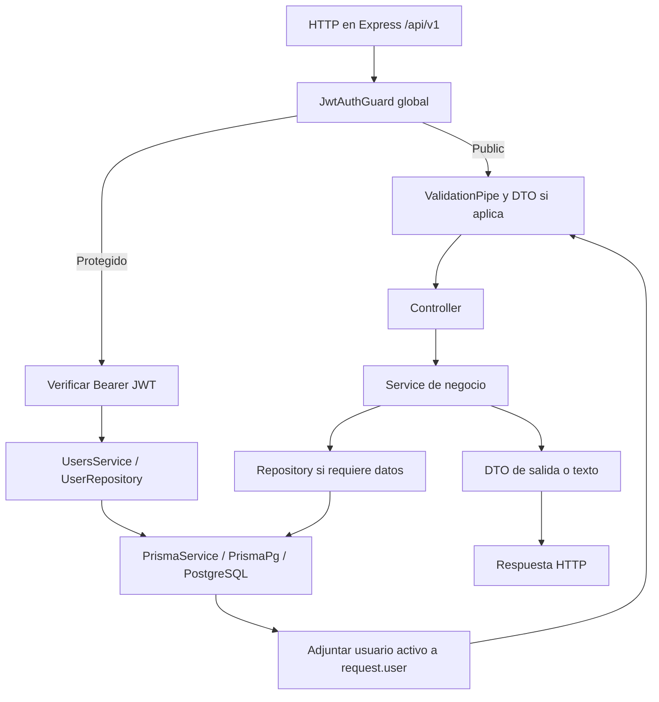
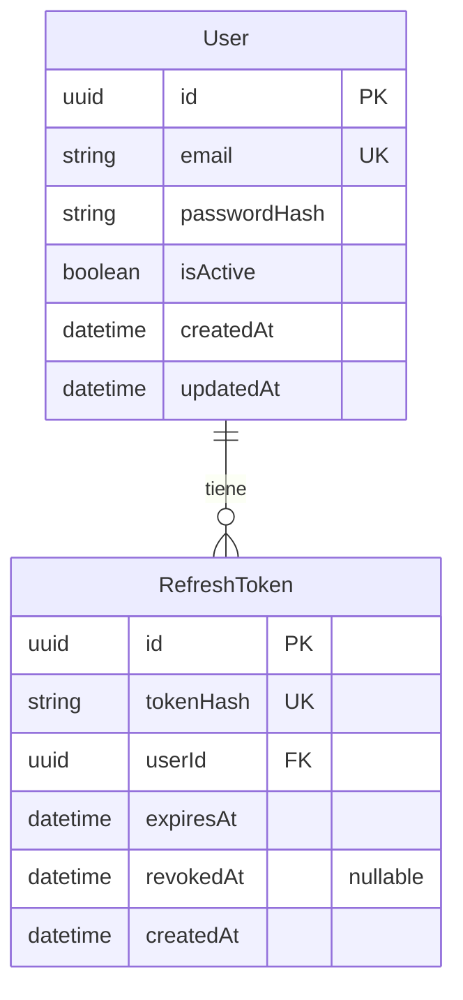
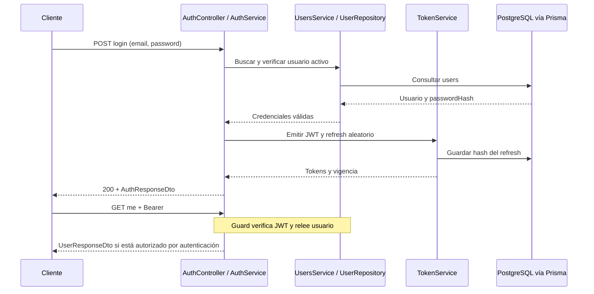
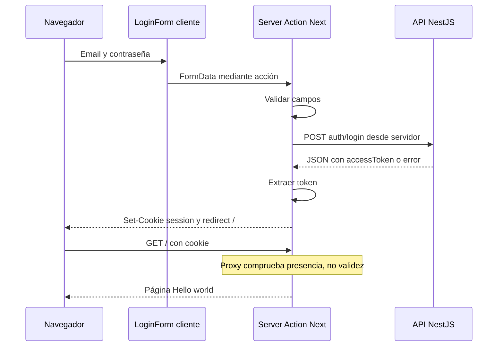
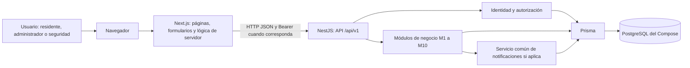
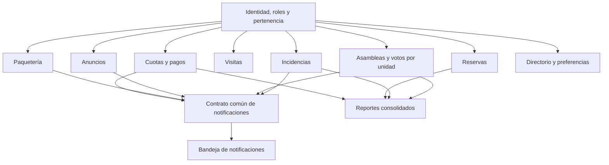

# Guía técnica y backlog preliminar: plataforma de condominios y edificios

> Edición para revisión en el fork, publicada por solicitud posterior del equipo. La arquitectura, estimaciones y asignaciones siguen siendo propuestas. Las referencias a conservación local, ausencia de commits/push y «esta ejecución» describen la etapa de planificación anterior; esta publicación posterior incorpora la documentación sin modificar aplicación ni protecciones.

> Actualización de alcance (16/10/2026): el equipo de cinco integrantes planifica los diez módulos y adaptación de autenticación en cuatro semanas. Se conserva el análisis técnico estático; esta corrección no implementa funcionalidades.

**Documento local de preparación del Proyecto 1.** Fecha: 16 de octubre de 2026. Equipo: Armando, Heber, Guille, Serrato y Yael.

Esta guía reúne el análisis de ambos boilerplates y propone cómo comenzar el proyecto. Está escrita para entender qué recibieron, qué pueden reutilizar, qué falta y cómo convertirlo en trabajo concreto. Contiene el detalle técnico necesario en este mismo archivo; los enlaces al código permiten comprobar las afirmaciones.

**Ubicación:** `IngSoft/documentacion/guia-tecnica-y-backlog-condominios.md`, al mismo nivel que las carpetas de backend y frontend. Este archivo no forma parte de ninguno de los dos repositorios y se conserva únicamente de manera local.

## Cómo leer esta guía

Las secciones 1 a 10 explican lo que ya existe. Las secciones 11 a 15 proponen arquitectura, organización y actividades futuras; las propuestas se distinguen de los requisitos de la cátedra. La sección 16 reúne el estado de Git, las fuentes y los límites de la revisión.

| Sección | Contenido |
|---|---|
| [1. Panorama](#panorama) | Explicación general y alcance académico |
| [2. Tecnologías backend](#backend-stack) | Versiones, herramientas, Docker y entorno |
| [3. Arquitectura backend actual](#backend-arquitectura) | Módulos, capas y recorrido HTTP |
| [4. Base de datos](#datos) | Modelos, campos, relaciones y migraciones |
| [5. Autenticación backend](#backend-auth) | Registro, JWT, renovación, logout y permisos faltantes |
| [6. API existente](#endpoints) | Los seis endpoints y sus contratos |
| [7. Frontend](#frontend-stack) | Tecnologías y funcionalidades disponibles |
| [8. Arquitectura frontend actual](#frontend-arquitectura) | Páginas, acciones, cookies y rutas |
| [9. Sesión frontend](#frontend-auth) | Qué funciona por lectura y qué falta integrar |
| [10. Integración](#integracion) | URLs, puertos y contratos entre proyectos |
| [11. Arquitectura recomendada](#arquitectura-propuesta) | Estructura, responsabilidades y decisiones iniciales |
| [12. Plataforma y módulos](#plataforma) | Requisitos, dependencias y conceptos compartidos |
| [13. Backlog](#backlog) | Actividades propuestas con prioridad, dependencia y aceptación |
| [14. Riesgos](#riesgos) | Problemas técnicos y decisiones por discutir |
| [15. Plan de trabajo](#plan) | Primera reunión, etapas y criterios de finalización |
| [16. Trazabilidad](#trazabilidad) | Git, fuentes y validación de este documento |

<a id="panorama"></a>

## 1. Panorama: qué tienen hoy

Tienen dos aplicaciones base separadas. **NestJS es el backend:** recibe solicitudes, valida datos, autentica usuarios y consulta PostgreSQL mediante Prisma. **Next.js es el frontend sobre React:** presenta pantallas y puede ejecutar lógica de servidor antes de llamar al backend. **PostgreSQL es la base de datos** y **Prisma es la herramienta que permite acceder a ella desde TypeScript**. Docker Compose describe cómo levantar backend y base juntos.

El esqueleto técnico existe; los procesos propios del condominio todavía no están desarrollados. No hay cuotas, reservas, visitas o votaciones guardadas en la base actual.

| Elemento | Lo que hay | Lo que todavía falta |
|---|---|---|
| Identidad | Registro de usuarios, comparación de contraseña y consulta del usuario activo | Relación con residente/unidad y política de altas |
| Autenticación API | JWT, refresh tokens persistidos, renovación y revocación | Revisión de concurrencia y pruebas del ciclo completo |
| Autorización | Verificación de que el usuario existe y está activo | Roles y permisos por recurso/unidad |
| Interfaz | Login con petición real y home Hello world | Pantallas y operaciones del dominio |
| Sesión web | Cookie HttpOnly y redirecciones por su presencia | Validación real, renovación y logout conectado al backend |
| Datos | User y RefreshToken, dos migraciones | Modelo del módulo y conceptos compartidos acordados |
| Entorno | Dockerfile/Compose de backend y plantillas de variables | Configuración local compatible y arranque verificado |
| Calidad | Dos pruebas básicas backend y herramientas de lint | Pruebas de autenticación, permisos e invariantes del dominio |

### Tres diferencias que deben entender desde el inicio

1. **Autenticarse y tener permisos son decisiones distintas.** Un JWT válido identifica al usuario; todavía no determina si puede registrar una visita o consultar la deuda de otra unidad.
2. **Tener una cookie no garantiza una sesión vigente.** El frontend solo comprueba su presencia, mientras la API verifica el JWT y relee al usuario.
3. **Tener archivos Docker y pruebas no demuestra que ya se ejecutaron correctamente.** La revisión realizada fue estática y no incluyó arranque, migraciones ni pruebas de aplicación.

### Alcance académico y del equipo

La fuente de negocio es el PDF suministrado, *Especificación de módulos y reglas del proyecto*, páginas 1-6 para reglas generales y Proyecto 1. Define los roles Residente, Administrador y Personal de seguridad, y los diez módulos resumidos en la sección 12.

El equipo ha confirmado que sus cinco integrantes desarrollarán los diez módulos más adaptación de autenticación en cuatro semanas. La diferencia con el reparto general del PDF se registra como aclaración para cátedra, sin limitar la planificación a un solo módulo.

El documento académico exige usar los repositorios base mediante forks, el Compose provisto, documentación de arquitectura, responsables en README y entrega con repositorios/demo. Permite cambios justificados de autenticación u ORM. En la fase ya realizada se conservaron ambos por la restricción del encargo de preparación: analizar y documentar sin cambiar código.

### Componentes que conviene reutilizar

La estructura de módulos Nest, sus DTOs, la normalización del email, los repositorios, el guard JWT y los mapeadores de salida ofrecen una base útil. En frontend pueden reutilizarse las páginas de login, Server Actions, cookie HttpOnly y estilos existentes. Esto requiere completar permisos e integración; no significa que esas piezas ya cubran las reglas del condominio.

---

<a id="backend-stack"></a>

## 2. Qué tecnologías y herramientas tiene el backend

Base analizada: `92a451f`; revisión estática del 16/10/2026. Los rangos declarados no deben confundirse con versiones instaladas: no hay instalación verificada. Las versiones resueltas siguientes proceden de [package-lock.json](../../package-lock.json).

### Stack comprobado

| Componente | Declaración en package.json | Resolución del lock / configuración |
|---|---|---|
| NestJS / Express | common, core y platform-express `^12.0.1` | core `12.0.3`; adaptador HTTP `@nestjs/platform-express` |
| Configuración | `@nestjs/config ^12.0.0` | `12.0.0`; validación propia al arranque |
| JWT | `@nestjs/jwt ^12.0.2` | `12.0.2`; HS256 configurado en AuthModule |
| OpenAPI | `@nestjs/swagger ^12.0.1` | `12.0.1`; interfaz en `/api/docs` |
| Prisma CLI / cliente / adaptador | `^7.10.0` | Prisma y cliente `7.10.0`; adaptador PostgreSQL |
| PostgreSQL | No se instala por npm | Imagen `postgres:18-alpine` en Compose |
| Driver PostgreSQL | `pg ^8.23.0` | Se usa a través de PrismaPg |
| Contraseñas | `bcrypt ^6.0.0` | Rondas configurables; 12 por defecto |
| DTOs | class-validator `^0.15.1`, class-transformer `^0.5.1` | ValidationPipe global y transformación de email |
| Lenguaje | TypeScript `^6.0.2` | Lock `6.0.3`; ESM, NodeNext y target ES2023 |
| Pruebas | Vitest `^4.1.2`, Supertest `^7.0.0`, @nestjs/testing | Vitest `4.1.11`; configs unitarias y e2e |
| Calidad | oxlint `^1.58.0`, oxlint-tsgolint, Prettier `^3.4.2` | `lint` usa análisis de tipos; `format` escribe archivos |

Fuente de rangos y scripts: [package.json](../../package.json). Otras dependencias de ejecución son `dotenv`, `reflect-metadata`, `rxjs` y `tsx`; esta última ejecuta el seed. No hay Passport, middleware de sesiones ni biblioteca RBAC declarados.

### Node.js

El manifiesto raíz no declara `engines` y no hay archivo de versión de Node versionado. [Dockerfile](../../Dockerfile) fija la familia `node:24-alpine`, no una versión patch. El [README](../../README.md) recomienda Node 22 o 24 y menciona ≥20.19; el lock precisa para Prisma `^20.19 || ^22.12 || >=24.0`, para Nest core `>=20` y para Swagger `^20.19.0 || >=22.12.0`. La intersección importa: no cualquier Node mayor a 20.19 satisface todos esos rangos. Se propone usar Node 24 como el contenedor, sin alterar configuración en esta fase.

### Construcción y calidad

`npm run build` ejecuta `nest build` y después `tsc-alias -p tsconfig.build.json`. [tsconfig.json](../../tsconfig.json) define alias por módulo, imports ESM y tipado estricto. [tsconfig.build.json](../../tsconfig.build.json) limita la compilación a `src`, excluyendo specs. El generador Prisma escribe bajo `src/generated/prisma`, ignorado por Git y regenerado mediante `postinstall`. Los barrels `index.ts` agrupan exportaciones.

`start:dev` y `start:debug` coordinan Nest y tsc-alias en modo watch con `concurrently`. `start:prod` ejecuta `dist/main.js`. [Configuración de oxlint](../../.oxlintrc.json) ignora archivos generados y detecta promesas no gestionadas. Prettier tiene configuración propia en `.prettierrc`; no se ejecutó `format` porque modificaría código base.

### Pruebas existentes y límites

[vitest.config.ts](../../vitest.config.ts) selecciona `**/*.spec.ts`, mientras [vitest.config.e2e.ts](../../vitest.config.e2e.ts) selecciona `**/*.e2e-spec.ts`; ambos habilitan globals y alias. Existe una prueba de [HealthController](../../src/health/controllers/health.controller.spec.ts) que verifica `Hello World!` y una [e2e](../../test/app.e2e-spec.ts) que monta AppModule y consulta `/`.

La e2e no ejecuta `bootstrap()` de main: no comprueba el prefijo `/api/v1`, el pipe ni Swagger tal como se configuran en producción; sí instancia módulos que necesitan variables y conexión PostgreSQL. No hay specs de autenticación, autorización o concurrencia en el inventario versionado. La presencia de herramientas y dos specs no demuestra cobertura suficiente ni pruebas aprobadas.

### Docker y configuración

[docker-compose.yml](../../docker-compose.yml) incluye `postgres` y `api`, healthcheck `pg_isready`, dependencia `service_healthy`, volumen `pgdata` en `/var/lib/postgresql` y puertos publicados. La API recibe la URL interna con host `postgres`; su comando aplica `prisma migrate deploy` antes de iniciar Node. Es ejecución configurada, no verificada aquí.

[Dockerfile](../../Dockerfile) tiene etapas deps, builder y runner: `npm ci` genera Prisma con una URL placeholder; compila, poda devDependencies y ejecuta como usuario `node`. El CMD directo solo inicia Node; la aplicación de migraciones la añade Compose. No hay servicio frontend en este Compose.

[env.validation.ts](../../src/config/env.validation.ts) requiere `DATABASE_URL` y `JWT_SECRET` de al menos 32 caracteres. Da defaults para `NODE_ENV`, `PORT`, `JWT_EXPIRES_IN`, `REFRESH_TOKEN_EXPIRES_IN_DAYS` y `BCRYPT_SALT_ROUNDS`. Los enteros deben ser positivos; no valida sintaxis de URL, duración JWT ni un máximo de rondas bcrypt. Las variables `POSTGRES_*` las consume Compose; su plantilla está en [.env.example](../../.env.example). No se reproducen valores de credenciales.

### Estado del entorno de esta revisión

Git y GitHub CLI están disponibles; cuenta autenticada: `ArmandoAgui`. `node`, `npm` y `docker` no se encontraron en PATH. No se ejecutaron builds, lint, tests, contenedores ni migraciones, y no se cambiaron dependencias. La siguiente fase deberá habilitar Node compatible y Docker Compose, conservar el Compose de la cátedra y verificar el arranque sobre una base de desarrollo antes de afirmar que existe integración funcional.

---

<a id="backend-arquitectura"></a>

## 3. Cómo está organizado el backend actual

### Organización

La aplicación es un monolito modular NestJS. [AppModule](../../src/app.module.ts) importa ConfigModule global con caché y validación, PrismaModule, HealthModule, UsersModule y AuthModule. No se encontraron módulos de condominios ni servicios independientes desplegables por dominio.

```text
src/
  main.ts                 bootstrap HTTP, prefijo, validación y Swagger
  app.module.ts           composición y guard global
  config/                 validación y tipo EnvConfig
  common/decorators/      normalización y validación de email
  health/                 controller, service y prueba
  users/                  controller, DTOs, service, repository y error de dominio
  auth/                   controller, DTOs, services, repository, guard y decoradores
  prisma/                 módulo global y PrismaService
prisma/                   schema, migraciones y seed
test/                     prueba e2e
```

### Módulos y dependencias

| Módulo | Componentes concretos | Responsabilidad |
|---|---|---|
| HealthModule | HealthController, HealthService | Respuesta simple de disponibilidad HTTP |
| UsersModule | UsersController, UsersService, UserRepository | Registro, hashing y acceso a usuarios; exporta service y repository |
| AuthModule | AuthController, AuthService, TokenService, RefreshTokenRepository, JwtAuthGuard | Autenticación, emisión/rotación/revocación de tokens; importa UsersModule y JwtModule asíncrono |
| PrismaModule | PrismaService global | Cliente Prisma y ciclo de conexión |
| ConfigModule | ConfigService con validateEnv | Dependencias y configuración desde entorno |

Fuentes: [HealthModule](../../src/health/health.module.ts), [UsersModule](../../src/users/users.module.ts), [AuthModule](../../src/auth/auth.module.ts), [PrismaModule](../../src/prisma/prisma.module.ts).

### Recorrido de una petición



El diagrama representa llamadas y retorno conceptual; no todas las rutas consultan la base. Health devuelve texto, y `/auth/me` utiliza el usuario cargado por el guard. En login, `@Public()` omite el guard y AuthService consulta credenciales mediante UsersService antes de emitir tokens. En registro, el service hashea y delega la inserción a UserRepository.

[main.ts](../../src/main.ts) crea la aplicación y establece el prefijo literal `api/v1` (no usa versionado dinámico de Nest). El [guard](../../src/auth/guards/jwt-auth.guard.ts) usa Reflector para leer `@Public()`. En rutas protegidas verifica el JWT y relee al usuario, rechazando cuentas inexistentes o inactivas; agrega la entidad a `request.user`. [CurrentUser](../../src/auth/decorators/current-user.decorator.ts) la extrae en el controller.

Después del guard, el ValidationPipe global aplica transformación, whitelist y rechazo de propiedades extra. Los controladores construyen DTOs explícitos de salida para excluir passwordHash. PrismaService extiende PrismaClient y usa PrismaPg con DATABASE_URL; [sus hooks](../../src/prisma/services/prisma.service.ts) conectan al iniciar el módulo y desconectan al destruirlo. `enableShutdownHooks()` habilita el cierre desde Nest.

### Patrones efectivamente implementados

- Inyección de dependencias por constructor con módulos y providers `@Injectable()`.
- Separación controller → service → repository → ORM, con repositorios concretos; no hay interfaces de repositorio inyectadas mediante tokens propios.
- DTOs y mapeadores estáticos `from` / `fromEntity` para contrato público.
- Guard global de autenticación y decoradores de metadatos/contexto.
- Traducción de error de persistencia: P2002 → EmailAlreadyTakenError → ConflictException ([repository](../../src/users/repositories/user.repository.ts), [service](../../src/users/services/users.service.ts)). Los tipos User de Prisma siguen presentes en servicios, por lo que no existe aislamiento total del ORM.

### Excepciones y componentes ausentes

Los services y el guard lanzan excepciones Nest (`UnauthorizedException`, `ConflictException`); la validación puede rechazar con 400. No hay filters, interceptors ni middlewares propios registrados; las respuestas de errores dependen del manejo estándar de Nest, sin contrato personalizado uniforme para toda excepción. Los errores de base no traducidos no tienen mapeo propio y pueden terminar como 500.

No se configura CORS en main. Tampoco hay autorización por roles, auditoría, rate limiting, colas, event bus, scheduler ni patrón outbox implementados. CQRS, microservicios, eventos de dominio o repositorios genéricos serían propuestas nuevas, no descripciones del boilerplate. Se recomienda conservar la organización actual como punto de partida y justificar cualquier ampliación con los módulos de la plataforma.

---

<a id="datos"></a>

## 4. Qué contiene la base de datos

Fuente principal: [prisma/schema.prisma](../../prisma/schema.prisma). Describe el esquema versionado, no una inspección de una base en ejecución.

### Modelos, campos y restricciones

| Modelo / tabla | Campo Prisma → SQL | Tipo y restricciones |
|---|---|---|
| User / users | id → id | String UUID, PK, `@default(uuid())` |
| | email → email | String, obligatorio, único |
| | passwordHash → password_hash | String obligatorio; hash bcrypt según UsersService |
| | isActive → is_active | Boolean obligatorio, default true |
| | createdAt → created_at | DateTime obligatorio, default now |
| | updatedAt → updated_at | DateTime obligatorio, `@updatedAt` |
| | refreshTokens | Relación inversa; no es columna |
| RefreshToken / refresh_tokens | id → id | String UUID, PK, `@default(uuid())` |
| | tokenHash → token_hash | String obligatorio, único; SHA-256 según TokenService |
| | userId → user_id | UUID obligatorio, FK a users.id e índice no único |
| | expiresAt → expires_at | DateTime obligatorio, sin default |
| | revokedAt → revoked_at | DateTime nullable; null representa no revocado |
| | createdAt → created_at | DateTime obligatorio, default now |
| | user | Relación por userId; no es otra columna |

SQL materializado: UUID para identificadores, TEXT para strings, BOOLEAN y TIMESTAMP(3) sin zona horaria. `uuid()` y `@updatedAt` se gestionan desde Prisma; la migración no añade defaults SQL para UUID ni updated_at. No hay enums, roles, checks financieros, unidades o condominios.

### Relaciones e índices

Un User tiene cero o muchos RefreshToken; cada token pertenece a exactamente un User. La relación declara `onDelete: Cascade`; la FK SQL incluye ON DELETE CASCADE y ON UPDATE CASCADE. Eliminar un usuario elimina sus tokens asociados.

Índices resultantes: PK `users_pkey`, único `users_email_key`, PK `refresh_tokens_pkey`, único `refresh_tokens_token_hash_key` y no único `refresh_tokens_user_id_idx`. No existe índice sobre expires_at ni unicidad por unidad, porque esa entidad aún no existe. El email se normaliza en aplicación; el índice único no constituye por sí mismo una restricción case-insensitive.



El diagrama utiliza los nombres Prisma; los mapeos físicos están en la tabla anterior.

### Historial de migraciones

1. [20260920172640_init](../../prisma/migrations/20260920172640_init/migration.sql): crea users con username, refresh_tokens, PKs, índices únicos, índice por usuario y FK.
2. [20260927163851_rename_username_to_email](../../prisma/migrations/20260927163851_rename_username_to_email/migration.sql): renombra la columna a email y el índice a users_email_key; ejecuta `lower(trim(email))` sobre valores existentes. No elimina la columna, pero la normalización puede colisionar con el índice único si hay datos previos equivalentes tras normalizar. Renombrar tampoco garantiza que todos los antiguos usernames sean emails válidos.

No se aplicaron migraciones ni se comprobó `_prisma_migrations`; se desconoce el estado de cualquier base local o remota.

### Cliente, conexión y seed

El generador `prisma-client` produce TypeScript ESM en `src/generated/prisma`, con runtime nodejs y engineType client. El datasource declara PostgreSQL; la URL del CLI está en [prisma.config.ts](../../prisma.config.ts) y la de ejecución en [PrismaService](../../src/prisma/services/prisma.service.ts) mediante PrismaPg. [Compose](../../docker-compose.yml) ofrece PostgreSQL 18 y persistencia en volumen; no se levantó.

[seed.ts](../../prisma/seed.ts) hace upsert de un usuario demo con email, hash bcrypt de costo 12 y `update: {}`; volverlo a ejecutar no cambia el registro existente. Incluye credenciales de demostración y las imprime en consola; no deben tratarse como configuración de producción ni copiarse a esta documentación. El seed no crea roles.

### Reutilización y decisiones pendientes

User puede servir como identidad de residentes, administradores y personal de seguridad; RefreshToken mantiene sesiones. No conviene duplicar credenciales en futuros perfiles de negocio. Esto es una recomendación; el schema no contiene esas relaciones.

Deben discutirse condominio, torre/sección, unidad y pertenencia, con sus cardinalidades, historial y alcance de permisos. La representación de roles y la distinción usuario/unidad son especialmente relevantes para votar una vez por unidad. No se propone aquí un schema definitivo ni se presupone multi-tenencia. También quedan pendientes políticas de borrado/auditoría, moneda, zona horaria y responsables de migraciones compartidas.

---

<a id="backend-auth"></a>

## 5. Cómo funciona la autenticación del backend

### Registro e inicio de sesión implementados

[UsersController](../../src/users/controllers/users.controller.ts) abre `POST /api/v1/users` con `@Public()`. [CreateUserDto](../../src/users/dto/create-user.dto.ts) exige email normalizado, contraseña string de 8 a 72 caracteres y al menos una minúscula, una mayúscula y un dígito. [IsNormalizedEmail](../../src/common/decorators/is-normalized-email.decorator.ts) recorta, pasa a minúsculas, valida email y limita a 254 caracteres. El pipe transforma antes de validar; UserRepository normaliza otra vez para llamadas internas.

[UsersService](../../src/users/services/users.service.ts) hashea con bcrypt y rondas de configuración, luego crea el usuario. El repositorio convierte P2002 en error de email ocupado y el service responde 409. [UserResponseDto](../../src/users/dto/user-response.dto.ts) expone únicamente id, email, isActive y createdAt. Registro no entrega tokens: después se debe hacer login.

[AuthController](../../src/auth/controllers/auth.controller.ts) acepta `POST /api/v1/auth/login`. LoginDto valida email y contraseña no vacía de hasta 72 caracteres, sin exigir la complejidad del registro. [AuthService](../../src/auth/services/auth.service.ts) busca usuario, compara bcrypt y verifica isActive. Email inexistente, clave incorrecta y cuenta inactiva responden el mismo 401. Para email inexistente compara contra un hash dummy para reducir diferencias de tiempo; no hay medición que demuestre tiempos indistinguibles.

### Tokens y renovación

[AuthModule](../../src/auth/auth.module.ts) configura JWT HS256 con secreto de entorno y vencimiento `JWT_EXPIRES_IN` (default 15m según [validateEnv](../../src/config/env.validation.ts)). [TokenService](../../src/auth/services/token.service.ts) firma payload `{ sub: user.id, email: user.email }`; no contiene rol. El refresh token son 32 bytes aleatorios codificados en hex; su SHA-256 se persiste con usuario y expiración (siete días por defecto).

Login y refresh devuelven [AuthResponseDto](../../src/auth/dto/auth-response.dto.ts): accessToken, refreshToken, expiresIn en segundos y user público. El backend no crea cookies ni usa sesiones de Express.

`POST /auth/refresh` recibe refreshToken, busca su hash con usuario y rechaza inexistentes, vencidos o usuarios inactivos. Si el token está revocado, revoca todas las sesiones de ese usuario. Si es válido, revoca ese registro y emite un par nuevo. [RefreshTokenRepository](../../src/auth/repositories/refresh-token.repository.ts) ofrece revocación por ID/hash, revocación global y borrado de expirados; no se encontró un scheduler que invoque la limpieza.

La lectura, revocación y creación no están dentro de una transacción ni usan una actualización condicional para reclamar el token. Dos renovaciones simultáneas podrían superar ambas la lectura de no revocado. La detección de reúso existe en el flujo secuencial, pero no garantiza exclusión bajo concurrencia. Es un riesgo inferido del código, no un fallo reproducido en esta revisión.

### Protección e identidad

[AppModule](../../src/app.module.ts) registra `JwtAuthGuard` como APP_GUARD mediante `useExisting`. Para proteger una nueva ruta basta conservar el guard global y no marcarla pública. `@ApiBearerAuth()` documenta Swagger; por sí solo no protege rutas.

El [guard](../../src/auth/guards/jwt-auth.guard.ts) lee Authorization, extrae Bearer, verifica JWT y consulta User por `sub`. Solo permite usuario existente y activo; lo adjunta a `request.user`. [CurrentUser](../../src/auth/decorators/current-user.decorator.ts) extrae esa identidad en `/auth/me`. Cada petición protegida consulta la base aunque la firma JWT sea verificable sin ella. No se exige coincidencia entre email del token y el actual; la identidad de consulta es sub.

**No hay roles implementados.** Ni User, ni el payload, ni los DTOs contienen rol. No existen RolesGuard, decorador Roles, permisos por recurso ni comprobaciones de pertenencia a condominio/unidad. Residente, Administrador y Personal de seguridad son requisitos del Proyecto 1 del PDF, no roles disponibles actualmente.

### Cierre de sesión y límites

`POST /auth/logout` es público y requiere RefreshTokenDto. Revoca por hash de forma idempotente y responde 204 incluso si el token ya no existe o estaba revocado. Revocar refresh no invalida un access token vigente: puede seguir aceptándose hasta expirar si el usuario permanece activo. Desactivar o borrar User sí bloquea peticiones protegidas por la relectura del guard.

No hay recuperación de contraseña, verificación de email, MFA, bloqueo por intentos, rate limiting ni UI de administración de usuarios. La API de registro es pública; deberá discutirse cómo se vinculará un usuario a una unidad sin otorgarle permisos arbitrarios. El límite de 72 se mide en caracteres mediante MaxLength; no garantiza un límite de 72 bytes UTF-8 para bcrypt, pese al comentario del DTO.

### Secuencia actual



La secuencia no añade autorización por rol. Se conserva esta implementación íntegra durante la fase de análisis.

---

<a id="endpoints"></a>

## 6. Qué endpoints existen y qué reciben

Base HTTP configurada: `http://localhost:3000/api/v1` en [main.ts](../../src/main.ts), con puerto configurable. Se identificaron seis handlers HTTP en tres controllers. Los métodos de repositorios no constituyen endpoints.

### Rutas y contratos

| Método y ruta completa | Controller → service | Entrada | Respuesta de éxito | Autenticación / roles |
|---|---|---|---|---|
| GET `/api/v1` (raíz del prefijo) | HealthController.getHello → HealthService.getHello | Ninguna | 200, texto `Hello World!` | Público; sin roles |
| POST `/api/v1/users` | UsersController.create → UsersService.create | CreateUserDto: email, password | 201, UserResponseDto | Público; sin roles |
| POST `/api/v1/auth/login` | AuthController.login → AuthService.login → TokenService.issueTokenPair | LoginDto: email, password | 200, AuthResponseDto | Público; sin roles |
| POST `/api/v1/auth/refresh` | AuthController.refresh → AuthService.refresh → TokenService.rotate | RefreshTokenDto: refreshToken | 200, AuthResponseDto; tokens nuevos | Público respecto al guard JWT; exige refresh válido; sin roles |
| POST `/api/v1/auth/logout` | AuthController.logout → AuthService.logout → TokenService.revoke | RefreshTokenDto: refreshToken | 204, sin cuerpo | Público respecto al guard JWT; revocación idempotente; sin roles |
| GET `/api/v1/auth/me` | AuthController.me; identidad cargada por JwtAuthGuard → UsersService.findById | Header Authorization: Bearer | 200, UserResponseDto | JWT y usuario activo; ningún rol restringido |

Fuentes: [HealthController](../../src/health/controllers/health.controller.ts), [UsersController](../../src/users/controllers/users.controller.ts), [AuthController](../../src/auth/controllers/auth.controller.ts), [guard](../../src/auth/guards/jwt-auth.guard.ts), [TokenService](../../src/auth/services/token.service.ts).

### DTOs de entrada

- [CreateUserDto](../../src/users/dto/create-user.dto.ts): email normalizado de hasta 254 caracteres; password string de 8-72 caracteres, con minúscula, mayúscula y dígito.
- [LoginDto](../../src/auth/dto/login.dto.ts): email normalizado; password string no vacío de hasta 72 caracteres.
- [RefreshTokenDto](../../src/auth/dto/refresh-token.dto.ts): refreshToken string no vacío, sin validación adicional de formato ni longitud máxima.

Los cuerpos son JSON. [ValidationPipe](../../src/main.ts) transforma DTOs y rechaza propiedades adicionales con 400. No se declararon query params, parámetros de ruta, paginación ni multipart en estos handlers.

### DTOs de salida

[UserResponseDto](../../src/users/dto/user-response.dto.ts):

```json
{
  "id": "<uuid>",
  "email": "<email normalizado>",
  "isActive": true,
  "createdAt": "<fecha ISO serializada>"
}
```

[AuthResponseDto](../../src/auth/dto/auth-response.dto.ts):

```json
{
  "accessToken": "<JWT>",
  "refreshToken": "<token opaco>",
  "expiresIn": 900,
  "user": {
    "id": "<uuid>",
    "email": "<email normalizado>",
    "isActive": true,
    "createdAt": "<fecha ISO serializada>"
  }
}
```

Son formas ilustrativas extraídas de los mapeadores, sin credenciales reales. 900 corresponde al default 15m, no a una constante del contrato: TokenService deriva expiresIn del JWT firmado. passwordHash, updatedAt y hashes de refresh no se devuelven en estos DTOs.

### Errores observables por lectura

| Ruta | Casos previstos por el código |
|---|---|
| users | 400 por DTO; 409 por email ocupado; errores no traducidos de persistencia pueden producir 500 |
| login | 400 por DTO; 401 genérico para credenciales inválidas/inactividad |
| refresh | 400 por DTO; 401 para token desconocido, expirado, revocado o usuario inactivo |
| logout | 400 por DTO; token desconocido o revocado sigue produciendo 204 |
| me | 401 por Bearer ausente, inválido o expirado, usuario inexistente o inactivo |

No hay lógica propia que produzca 403 por roles. Los mensajes de errores Nest dependen del caso; `message` puede ser una lista en validación. El texto Swagger de conflicto en UsersController aún dice nombre de usuario, mientras el contrato real usa email.

### Documentación y alcance

[main.ts](../../src/main.ts) registra Swagger en `/api/docs`, con esquema Bearer. Es una ruta de documentación configurada aparte del inventario de seis handlers de negocio; no está protegida mediante un controller propio. Swagger registra también sus recursos de documentación, no enumerados como funcionalidades del dominio.

El health check devuelve texto y no consulta disponibilidad de PostgreSQL; no debe interpretarse como readiness completa de todas las dependencias. No existen endpoints de roles, condominios, unidades ni de los diez módulos. Esta revisión no hizo solicitudes contra un servidor ni generó evidencia de respuestas en ejecución.

---

<a id="frontend-stack"></a>

## 7. Qué tecnologías y funcionalidades tiene el frontend

Fecha: 16/10/2026. Código base: `861ee563ad9716638fd0b318991a505440e1057a`. Proyecto 1: plataforma de condominios. Revisión estática sin modificar código ni dependencias.

### Tecnologías verificadas

| Área | Estado real y evidencia |
|---|---|
| Framework | Next.js `16.3.6` sobre React y React DOM `19.2.8`, versiones exactas en [package.json](https://github.com/ArmandoAgui/fe_boilerplate_is_2026/blob/861ee563ad9716638fd0b318991a505440e1057a/package.json) y [lock](https://github.com/ArmandoAgui/fe_boilerplate_is_2026/blob/861ee563ad9716638fd0b318991a505440e1057a/package-lock.json) |
| Lenguaje | TypeScript `^5`, lock `5.9.3`; `.tsx` en UI y `.ts` en acciones/configuración |
| Construcción | Scripts `next dev`, `next build` y `next start`; no es una SPA Vite |
| Node | No hay engines raíz ni archivo de versión; entrada Next del lock requiere `>=20.9.0`. `@types/node ^20` es tipado, no la versión instalada de Node |
| Estilos | Tailwind `^4` (lock `4.3.3`), plugin `@tailwindcss/postcss` y [CSS global](https://github.com/ArmandoAgui/fe_boilerplate_is_2026/blob/861ee563ad9716638fd0b318991a505440e1057a/app/globals.css) con variables de color y modo oscuro por preferencia del sistema |
| UI | HTML y clases Tailwind; sin sistema de componentes externo declarado |
| Rutas | App Router basado en `app/`; `next/navigation` para redirect y `proxy.ts` para redirecciones |
| HTTP | fetch nativo en una Server Action; no hay Axios ni instancia/interceptores HTTP |
| Formularios | React `useActionState`, FormData y validación HTML; no hay React Hook Form, Formik ni Zod |
| Estado | Estado local del formulario y cookie de sesión; no hay Redux, Zustand ni contexto global de usuario |
| Calidad | ESLint `^9`, lock `9.39.5`, eslint-config-next `16.3.6`; config de TypeScript estricta |
| Pruebas | No se encontraron specs ni script de test o framework de pruebas declarado |

El [lock](https://github.com/ArmandoAgui/fe_boilerplate_is_2026/blob/861ee563ad9716638fd0b318991a505440e1057a/package-lock.json) refleja resoluciones, no paquetes instalados en esta revisión. [AGENTS.md](https://github.com/ArmandoAgui/fe_boilerplate_is_2026/blob/861ee563ad9716638fd0b318991a505440e1057a/AGENTS.md) solicita consultar las guías incluidas en node_modules/next antes de escribir código; esta fase solo crea Markdown y no implementa código Next.

### Funcionalidades implementadas

La [página login](https://github.com/ArmandoAgui/fe_boilerplate_is_2026/blob/861ee563ad9716638fd0b318991a505440e1057a/app/login/page.tsx) monta [LoginForm](https://github.com/ArmandoAgui/fe_boilerplate_is_2026/blob/861ee563ad9716638fd0b318991a505440e1057a/app/login/login-form.tsx), con email, contraseña, mensajes accesibles y botón deshabilitado durante envío. La [acción login](https://github.com/ArmandoAgui/fe_boilerplate_is_2026/blob/861ee563ad9716638fd0b318991a505440e1057a/app/actions/auth.ts) valida datos, llama realmente al backend, obtiene un access token, crea cookie y redirige a `/`. La [página inicial](https://github.com/ArmandoAgui/fe_boilerplate_is_2026/blob/861ee563ad9716638fd0b318991a505440e1057a/app/page.tsx) muestra Hello world y botón para cerrar sesión. No hay dashboards o módulos de condominios.

[lib/session.ts](https://github.com/ArmandoAgui/fe_boilerplate_is_2026/blob/861ee563ad9716638fd0b318991a505440e1057a/lib/session.ts) guarda la cookie session, HttpOnly, SameSite lax, Secure en producción y vigencia de siete días. [proxy.ts](https://github.com/ArmandoAgui/fe_boilerplate_is_2026/blob/861ee563ad9716638fd0b318991a505440e1057a/proxy.ts) comprueba si existe cookie para redirigir al login o al inicio. Esto constituye una implementación parcial de sesión; no prueba autenticación válida ni roles.

La especificación PDF describe una pantalla genérica sin mecanismo de autenticación de fondo. El commit encontrado ya añade petición de login y cookies. Se documenta esta diferencia para evitar rehacer trabajo o asumir que el flujo completo ya está resuelto.

### Herramientas y configuración

[tsconfig.json](https://github.com/ArmandoAgui/fe_boilerplate_is_2026/blob/861ee563ad9716638fd0b318991a505440e1057a/tsconfig.json) usa target ES2017, resolución bundler, strict, noEmit, JSX de React y alias `@/*` a la raíz. Incluye tipos generados por Next. [eslint.config.mjs](https://github.com/ArmandoAgui/fe_boilerplate_is_2026/blob/861ee563ad9716638fd0b318991a505440e1057a/eslint.config.mjs) combina reglas core-web-vitals y TypeScript; ignora `.next`, out, build y next-env.d.ts. [next.config.ts](https://github.com/ArmandoAgui/fe_boilerplate_is_2026/blob/861ee563ad9716638fd0b318991a505440e1057a/next.config.ts) exporta configuración vacía; [postcss.config.mjs](https://github.com/ArmandoAgui/fe_boilerplate_is_2026/blob/861ee563ad9716638fd0b318991a505440e1057a/postcss.config.mjs) activa Tailwind.

El [layout raíz](https://github.com/ArmandoAgui/fe_boilerplate_is_2026/blob/861ee563ad9716638fd0b318991a505440e1057a/app/layout.tsx) configura español, metadatos y fuentes Geist/Geist Mono mediante next/font/google. La compilación puede depender de obtener esas fuentes según el entorno; no se intentó build. El CSS body declara Arial/Helvetica aunque el layout también define variables de fuentes.

### Entorno y límites de validación

El README contiene instrucciones genéricas de Next; no documenta todavía la integración del proyecto. [.env.example](https://github.com/ArmandoAgui/fe_boilerplate_is_2026/blob/861ee563ad9716638fd0b318991a505440e1057a/.env.example) define únicamente API_URL, con puerto 8000 y sin `/api/v1`. El repositorio no contiene Dockerfile ni Compose para frontend. La base de Docker de la cátedra pertenece al backend y debe conservarse según el PDF.

En esta sesión no se encontraron node, npm o docker en PATH. No se instalaron dependencias ni se ejecutaron lint, build, servidor o pruebas. Se verifican documentos y Git; no se afirma que exista una demo funcionando. Los ajustes de entorno y pruebas se proponen para la siguiente fase en [integración](#integracion).

---

<a id="frontend-arquitectura"></a>

## 8. Cómo está organizado el frontend actual

### Estructura y responsabilidades

```text
app/
  layout.tsx              layout raíz, idioma, fuentes y metadata
  globals.css             Tailwind, tema y estilos base
  page.tsx                inicio y formulario logout
  login/page.tsx          pantalla de acceso
  login/login-form.tsx    componente cliente del formulario
  actions/auth.ts         acciones de servidor login/logout y fetch
lib/
  session.ts              lectura, escritura y eliminación de cookie
proxy.ts                  redirección por presencia de cookie
public/                   SVGs de plantilla
```

La estructura procede de los archivos versionados; no existen carpetas de módulos de condominios, repositorios de datos, cliente API compartido, hooks personalizados, providers o stores globales.

### Componentes y límites cliente/servidor

[layout.tsx](https://github.com/ArmandoAgui/fe_boilerplate_is_2026/blob/861ee563ad9716638fd0b318991a505440e1057a/app/layout.tsx), [page.tsx](https://github.com/ArmandoAgui/fe_boilerplate_is_2026/blob/861ee563ad9716638fd0b318991a505440e1057a/app/page.tsx) y [login/page.tsx](https://github.com/ArmandoAgui/fe_boilerplate_is_2026/blob/861ee563ad9716638fd0b318991a505440e1057a/app/login/page.tsx) no declaran `use client`; mantienen el modelo de componentes de servidor de Next. [login-form.tsx](https://github.com/ArmandoAgui/fe_boilerplate_is_2026/blob/861ee563ad9716638fd0b318991a505440e1057a/app/login/login-form.tsx) sí declara `use client` y usa `useActionState` para datos del formulario, errores y pending. No consulta la API directamente desde el navegador.

[auth.ts](https://github.com/ArmandoAgui/fe_boilerplate_is_2026/blob/861ee563ad9716638fd0b318991a505440e1057a/app/actions/auth.ts) declara `use server`. Su función authenticate privada concentra el único fetch del proyecto. login convierte FormData a strings, valida y llama al backend; logout borra cookie. [session.ts](https://github.com/ArmandoAgui/fe_boilerplate_is_2026/blob/861ee563ad9716638fd0b318991a505440e1057a/lib/session.ts) usa cookies de Next y exporta createSession, getSession, deleteSession y SESSION_COOKIE. getSession existe, pero no se consume en las páginas ni en auth.ts; proxy consulta las cookies del request directamente.

No hay un contexto global del usuario ni proveedor de sesión envolviendo el árbol. El único estado de UI explícito es el del formulario; para estado compartido futuro debe evaluarse la necesidad antes de elegir una librería.

### Flujo de login actual



La secuencia presupone una API_URL correcta y respuesta satisfactoria. No incluye refresh, consulta de usuario ni roles porque no están implementados. El token solo se guarda como valor de cookie, sin wrapper de sesión firmado adicional; el propio JWT procede del backend.

### Enrutamiento y manejo de errores

[proxy.ts](https://github.com/ArmandoAgui/fe_boilerplate_is_2026/blob/861ee563ad9716638fd0b318991a505440e1057a/proxy.ts) considera pública exactamente `/login`. Su matcher excluye rutas api, recursos internos indicados de Next, favicon y algunas extensiones de imágenes. Redirige al login si falta cookie en ruta no pública; si hay cookie en login redirige al inicio. No decide permisos por rol ni debe utilizarse como única autorización de futuras acciones o endpoints excluidos del matcher.

Los errores de validación y credenciales vuelven como LoginState y se presentan en un párrafo con `aria-live`. Los fallos de red, configuración y respuestas inesperadas se registran en servidor y producen un mensaje genérico. `redirect('/')` está fuera del catch de autenticación. No se encontraron error boundaries propios (`error.tsx`), interceptores de respuesta ni un mecanismo global de recuperación de sesión.

### Patrones existentes y propuestas separadas

Existe separación pequeña entre UI, acciones de servidor y utilidades de cookie, con enrutamiento por archivos. No hay arquitectura Redux, MVVM, CQRS ni cliente HTTP centralizado. Crear un servicio API con manejo común de Bearer/errores o componentes de layout por rol sería trabajo futuro; no se presenta como una capa ya disponible.

La estructura puede ampliarse conservando estas responsabilidades, después de acordar sesión y permisos con el backend. Los contratos de integración y limitaciones están en [04-integracion-backend.md](#integracion).

---

<a id="frontend-auth"></a>

## 9. Cómo funciona la sesión web y qué le falta

### Pantalla y validaciones

[LoginForm](https://github.com/ArmandoAgui/fe_boilerplate_is_2026/blob/861ee563ad9716638fd0b318991a505440e1057a/app/login/login-form.tsx) incluye etiquetas, email con `type=email`, contraseña, autocompletado, required, mensajes aria-live y estado pending del botón. useActionState conserva email y error; no conserva la contraseña dentro del estado devuelto.

La [Server Action login](https://github.com/ArmandoAgui/fe_boilerplate_is_2026/blob/861ee563ad9716638fd0b318991a505440e1057a/app/actions/auth.ts) recorta email, comprueba presencia de ambos campos y aplica una expresión regular sencilla de email. No impone largo máximo ni las mismas reglas del DTO backend; este continúa siendo responsable de validar el contrato. El frontend no convierte el email a minúsculas; el backend sí normaliza. No hay formulario de registro o recuperación.

### Petición real y procesamiento de respuesta

authenticate exige `process.env.API_URL`; construye la URL con `new URL("auth/login", apiUrl.replace(/\/?$/, "/"))`. Ejecuta fetch POST con JSON `{ email, password }`, Content-Type application/json y cache no-store desde el servidor Next.

Si recibe 401 o 403 devuelve null y muestra error de credenciales. Otros estados no exitosos lanzan error; también se capturan fallos de red/JSON. Busca el token en `data.token ?? data.accessToken ?? data.access_token`. El contrato actual de Nest usa accessToken y coincide con esa extracción; no hay validación de esquema de la respuesta.

Solo devuelve el access token; descarta `refreshToken`, `expiresIn` y `user`. No se llama a `/auth/me`, `/auth/refresh` o `/auth/logout` del backend. El hecho de aceptar tres nombres de token no implica tres contratos soportados por Nest.

### Persistencia y rutas

[createSession](https://github.com/ArmandoAgui/fe_boilerplate_is_2026/blob/861ee563ad9716638fd0b318991a505440e1057a/lib/session.ts) escribe `session` con el token, HttpOnly, path `/`, SameSite lax y Secure cuando NODE_ENV es production. Define expires siete días después, independiente del vencimiento JWT. No hay localStorage ni sessionStorage y no se entrega el token al componente cliente como parte de LoginState.

[proxy.ts](https://github.com/ArmandoAgui/fe_boilerplate_is_2026/blob/861ee563ad9716638fd0b318991a505440e1057a/proxy.ts) solo comprueba si existe un valor de cookie. No verifica firma, expiración, usuario activo ni permisos. Una cookie arbitraria o vencida puede permitir abrir la página estática Hello world; eso no permite por sí mismo acceder a endpoints Nest protegidos, que verifican Bearer y usuario activo. Tampoco se envía la cookie automáticamente como Authorization hacia Nest.

La home actual no obtiene datos del usuario. Existe getSession en lib/session.ts, pero no un flujo que lo use para cargar identidad o datos del dominio. Si hay cookie inválida, entrar a `/login` redirige al inicio y no ofrece recuperar sesión mediante el login; el logout local permite borrarla.

### Logout y vigencia

La acción logout elimina la cookie y redirige a `/login`; no revoca refresh en Nest. El backend emite access token con 15m y refresh de siete días por defecto, mientras frontend conserva solo el primero durante siete días. Esa diferencia deja una interfaz que cree tener sesión cuando el backend ya la rechazaría. Es una conclusión del flujo y defaults del código, sin prueba de ejecución.

### Trabajo pendiente propuesto

1. Corregir API_URL y decidir puertos en una fase de implementación; ver [integración](#integracion).
2. Acordar dónde almacenar refresh de forma segura en el modelo servidor/cookie y cómo sincronizar expiración; coordinar renovación para no disparar múltiples canjes del mismo token.
3. Obtener usuario y validar sesión con backend antes de operaciones protegidas. El proxy puede seguir sirviendo como redirección temprana, sin sustituir controles de servidor.
4. Completar logout con revocación del refresh; definir reacción ante 401, errores de red, sesión revocada o cuenta inactiva.
5. Definir roles y permisos del Proyecto 1 en conjunto con backend; no existen actualmente ni deben inferirse desde la UI.
6. Elegir estado global solo cuando haya necesidades concretas; no es obligatorio introducir Redux o Zustand para guardar tokens en JavaScript del navegador.
7. Verificar login correcto/incorrecto, validación, vencimiento, renovación concurrente y logout entre pestañas mediante pruebas apropiadas.

Estos puntos son recomendaciones pendientes y no cambios hechos en esta entrega. Se conserva la autenticación existente.

---

<a id="integracion"></a>

## 10. Cómo se conectan los dos proyectos

Bases analizadas: frontend `861ee56`, backend `92a451f`. Los archivos del backend citados como `backend: ruta` se encuentran en el fork `ArmandoAgui/be_boilerplate_is_2026`; las rutas con enlaces relativos son de este frontend.

### Compatibilidad existente

| Elemento | Frontend | Backend | Evaluación |
|---|---|---|---|
| Login | [auth.ts](https://github.com/ArmandoAgui/fe_boilerplate_is_2026/blob/861ee563ad9716638fd0b318991a505440e1057a/app/actions/auth.ts): POST auth/login con email/password | `src/auth/controllers/auth.controller.ts`, LoginDto | Método, sufijo y nombres de campos coinciden |
| Respuesta | Reconoce accessToken (también dos alias) | AuthResponseDto devuelve accessToken, refreshToken, expiresIn, user | Token compatible; resto se descarta |
| Registro | No existe pantalla/acción | POST `/api/v1/users` | Solo backend implementado |
| Identidad | No se consulta usuario | GET `/api/v1/auth/me` protegido | Contrato disponible, consumidor pendiente |
| Renovación | No implementada | POST `/api/v1/auth/refresh` con rotación | Backend disponible con riesgo de concurrencia |
| Logout | Borra cookie | POST `/api/v1/auth/logout` revoca refresh | No están conectados |
| Roles | Sin permisos de UI | Sin campo rol ni guard RBAC | Pendiente en ambos |
| Datos de negocio | Sin pantallas de condominios | Solo User/RefreshToken | Diez módulos pendientes |

### URLs y puertos

La plantilla [.env.example](https://github.com/ArmandoAgui/fe_boilerplate_is_2026/blob/861ee563ad9716638fd0b318991a505440e1057a/.env.example) configura `API_URL=http://localhost:8000`. Al añadir `auth/login`, la acción llama `http://localhost:8000/auth/login`. Backend `src/main.ts` define prefijo `/api/v1` y puerto 3000 por defecto; Compose publica `${PORT:-3000}:3000`. Por tanto, las configuraciones de ejemplo no forman una integración directa compatible.

**Configuración propuesta, no aplicada:** ejecutar backend en host 3000 y frontend en 3001, con `API_URL=http://localhost:3000/api/v1` en el entorno del servidor Next. La construcción actual añade la barra y produce `http://localhost:3000/api/v1/auth/login`. Para iniciar Next en 3001 se podría usar `npm run dev -- --port 3001`; no se modifican scripts ni se ejecuta aquí.

Otra posibilidad es publicar la API en host 8000 mediante PORT de Compose y configurar `API_URL=http://localhost:8000/api/v1`. En Compose el puerto interno sigue siendo 3000. No confundir puerto publicado, puerto de escucha dentro del contenedor y prefijo HTTP.

Si Next se ejecuta en otro contenedor de la misma red, localhost refiere a ese contenedor; la URL deberá usar el servicio API, por ejemplo `http://api:3000/api/v1`, siempre que se conecte a la misma red. El Compose entregado solo define api/postgres; no contiene esa configuración frontend. En despliegue la URL debe ser alcanzable desde el servidor Next, no necesariamente desde el navegador. API_URL es de servidor y no tiene prefijo NEXT_PUBLIC.

### Transporte, CORS y errores

El navegador envía el formulario a Next; Next ejecuta fetch hacia Nest. Por esa topología servidor→servidor, el login actual no requiere CORS entre navegador y API. Backend no llama enableCors en main. Una futura llamada directa desde navegador a otro origen sí necesitará una decisión explícita de CORS y credenciales; aún no está configurada.

No hay interceptores HTTP, cliente compartido, timeout explícito, refresh automático ni agregado general de Authorization: Bearer. [proxy.ts](https://github.com/ArmandoAgui/fe_boilerplate_is_2026/blob/861ee563ad9716638fd0b318991a505440e1057a/proxy.ts) tampoco reenvía tokens a la API. La cookie de Next no sustituye el header exigido por JwtAuthGuard.

La acción diferencia 401/403 de otros errores, pero no muestra mensajes de validación específicos de Nest. Respuestas malformadas o sin token muestran error genérico. El contrato backend responde 400 por DTO y propiedades extra, 409 por registro duplicado, 401 por autenticación y 204 por logout; no hay rol que produzca 403 actualmente. Falta estandarizar cómo consumir esos errores en futuras pantallas.

### Clasificación del estado

| Categoría | Componentes |
|---|---|
| Implementado por lectura de código | Registro y ciclo de tokens en API; formulario y fetch login en Next; cookie y logout local; guard JWT en backend |
| Configurado pero sin flujo completo de consumo | Cookie de siete días sin relación con TTL real; getSession exportado sin uso en UI; Bearer en Swagger, sin cliente frontend para rutas protegidas; APIs refresh/me/logout sin consumidor frontend |
| Pendiente | URLs coherentes, puertos simultáneos, sesión validada y renovable, logout remoto, roles/pertenencia, módulos de negocio y pruebas integradas |
| Propuesta de mejora | Servicio API de servidor común, manejo compartido de errores, renovación coordinada, decisiones de estado justificadas y pruebas por criterio de negocio |

Que un componente esté implementado no significa que se probó en ejecución. Esta sesión no tiene node/npm/docker en PATH; no se arrancaron servidores ni se ejecutaron migraciones o tests.

### Riesgos para los diez módulos

Sin autorización por rol y unidad no se pueden proteger estados de cuenta, visitas, paquetes, votos ni datos privados del directorio. Identidad y pertenencia deben tener contrato común. Cuotas, reservas y votaciones necesitarán consistencia e idempotencia; reportes dependerán de definiciones de datos de esos módulos, y notificaciones de un contrato transversal. El backend actual no implementa esas garantías de negocio.

Para este equipo se confirma el desarrollo de los diez módulos y adaptación de autenticación. La distribución general del PDF entre diez equipos se aclarará con cátedra, sin reducir el alcance. Los contratos entre módulos y responsables se acuerdan dentro del equipo de cinco integrantes.

### Verificación futura propuesta

1. Habilitar Node compatible y Docker Compose; conservar el Compose de cátedra y configurar secretos locales fuera de Git.
2. Levantar entorno de desarrollo aislado y aplicar migraciones revisadas; usar seed demo solo en desarrollo.
3. Probar health por `/api/v1`, login válido/erróneo y registro; inspeccionar atributos de cookie sin publicar su valor.
4. Incorporar y probar consulta de usuario, vencimiento, renovación y logout remoto cuando se implemente la sesión completa.
5. Probar permisos y aislamiento por unidad/rol antes de conectar pantallas de los módulos de la plataforma.

### Git de esta entrega

Fork: `https://github.com/ArmandoAgui/fe_boilerplate_is_2026`. Rama: `docs/analisis-inicial`. origin apunta al fork; upstream lee `https://github.com/nrecinos2001/fe_boilerplate_is_2026.git` y su URL de push es `disabled://upstream-read-only`.

La configuración local usa push por defecto a origin, main con pushRemote disabled y un hook `.git/protection-hooks/pre-push` que solo permite la rama de documentación al fork exacto. Se comprobó su rechazo para upstream y main sin enviar nada a la cátedra. Es protección local, no regla de GitHub, y no se copia automáticamente al clonar. Se preserva main en `861ee563ad9716638fd0b318991a505440e1057a`; la entrega agrega únicamente los cuatro documentos de docs, sin PR ni merge.

---

<a id="arquitectura-propuesta"></a>

## 11. Arquitectura recomendada para empezar

La arquitectura compartida actualizada para los diez módulos se detalla en [02-arquitectura-propuesta.md](02-arquitectura-propuesta.md); esta explicación técnica conserva su utilidad como introducción.

**Propuesta técnica:** mantener un monolito modular NestJS, un frontend Next.js y una base PostgreSQL compartida con acceso mediante Prisma. Conservar el Compose de la cátedra. Esta propuesta amplía la base que ya existe y debe discutirse en el equipo; no describe funcionalidades nuevas implementadas.

Un monolito modular es una sola aplicación backend con responsabilidades separadas por módulo. Cuotas y reservas pueden vivir en módulos distintos sin requerir servidores, repositorios o despliegues independientes para cada uno. Cada cambio debería conservar esos límites para que la aplicación no termine como un conjunto de tablas y controladores mezclados.

### 11.1 Vista propuesta del sistema



Las cajas de dominio y notificaciones son propuestas. El código actual solo implementa autenticación, usuarios y health. La flecha de Next hacia Nest representa la orientación recomendada para conservar la lógica de servidor que el login ya utiliza.

### 11.2 Qué debe decidir cada parte

| Parte | Responsabilidad recomendada | Ejemplo |
|---|---|---|
| Componentes/páginas Next | Presentar datos, pedir información, mostrar errores y estados | Formulario para reportar incidencia |
| Acciones y cliente API del servidor Next | Leer sesión, llamar a API y traducir respuestas a estados de pantalla | Enviar descripción y referencias de evidencias con Bearer |
| Guard/autorización Nest | Verificar identidad y permisos del actor | Impedir consultar una incidencia ajena si la política no lo permite |
| Controller Nest | Recibir DTO, invocar caso de uso y devolver contrato | POST de creación o GET de consulta |
| Service de negocio | Aplicar reglas, estados y coordinación transaccional | Validar una transición de estado permitida |
| Repository / Prisma | Ejecutar consultas y persistencia con restricciones | Insertar reporte e historial de manera consistente |
| PostgreSQL | Mantener integridad referencial y restricciones de datos | Evitar registros huérfanos y duplicados donde corresponda |

La API debe ser la autoridad de las reglas. Ocultar un botón sirve a la experiencia de usuario, pero no protege la operación. Las transacciones que afectan varias operaciones de persistencia deben coordinarse desde el caso de uso con una forma explícita de compartir la transacción entre repositorios; no basta abrir transacciones independientes en cada repositorio.

### 11.3 Organización sugerida del backend

Conservar `auth`, `users`, `health`, `prisma` y `config`. Agregar los diez módulos del Proyecto 1 y los contratos compartidos aprobados, de forma incremental y con límites claros. Un ejemplo conceptual sería:

```text
src/
  auth/                    autenticación existente y autorización por acordar
  users/                   identidad existente
  prisma/                  acceso común a la base
  config/                  validación de entorno
  common/                  utilidades realmente compartidas
  <modulo-de-negocio>/
    controllers/           interfaz HTTP
    dto/                   entradas y salidas
    services/              reglas/casos de uso
    repositories/          persistencia
```

No es una instrucción para crear todas estas carpetas ahora. Una abstracción compartida debe aparecer cuando exista un uso real, evitando que common absorba reglas de negocio. Si dos módulos necesitan la misma entidad, acordar un dueño y contrato antes de duplicarla. Las migraciones siguen un único historial coordinado.

### 11.4 Organización sugerida del frontend

Mantener App Router para páginas y layouts. Organizar pantallas por función del negocio y, cuando haya reutilización real, extraer componentes y servicios. Una estructura posible sería:

```text
app/
  login/
  <pantallas-del-modulo>/   rutas y layouts necesarios
  actions/                 acciones de servidor
components/                componentes compartidos cuando existan
lib/
  session.ts               sesión del servidor
  api/                     llamadas comunes a Nest y manejo de errores
features/
  <modulo>/                componentes y lógica específicos si el tamaño lo amerita
```

Las carpetas adicionales son opcionales. Para un módulo pequeño puede bastar agrupar componentes junto a su ruta. Evitar que las carpetas app y features dupliquen la misma responsabilidad.

### 11.5 Estado de interfaz y datos

Empezar con `useActionState` para formularios y estado local para interacción simple. Los datos persistentes y permisos pertenecen al backend; la identidad de sesión se resuelve desde el servidor. Un contexto pequeño puede servir para datos de presentación del usuario si varios componentes lo necesitan, sin convertirse en la autoridad de permisos.

Evaluar una biblioteca adicional de estado o caché cuando aparezca una necesidad concreta: muchos componentes compartiendo estado mutable, filtros complejos o actualización de datos en cliente. Registrar la razón antes de añadir dependencias. No se recomienda guardar tokens en un store del navegador ni asumir que Redux/Zustand son requisitos académicos.

### 11.6 Sesión y cliente API propuestos

Completar el patrón servidor Next → API Nest ya iniciado. El servidor Next debe obtener el access token de una sesión HttpOnly, añadir Bearer al consultar rutas protegidas y obtener el usuario desde la API. Antes de implementar renovación deben acordarse almacenamiento y protección del refresh, expiración, revocación y comportamiento ante fallo.

La alternativa concreta de almacenamiento de refresh debe registrarse como decisión: cookie HttpOnly con atributos y duración adecuados o sesión del lado servidor con identificador opaco en cookie. La segunda introduce almacenamiento de sesión adicional; la primera exige cuidar exposición por origen/ruta, manejo de cookies y controles contra solicitudes no autorizadas. No se aprueba ninguna de las dos con este documento.

La renovación debe coordinarse para que varias solicitudes o pestañas no canjeen a la vez el mismo refresh. Revisar también el consumo atómico del refresh en Nest. Ante rechazo definitivo, limpiar sesión y volver a login; un fallo temporal de red debe poder distinguirse de credenciales inválidas. Logout debe revocar refresh y borrar la sesión local según una política explícita, incluso si la API no responde.

No es necesario compartir JWT_SECRET con el frontend para mostrar identidad: Next puede consultar `/auth/me`. La API mantiene la verificación autoritativa. Cualquier operación que modifique datos necesita tanto sesión válida como autorización en Nest; la redirección de proxy no sustituye estos controles.

### 11.7 Modelo conceptual y permisos antes de diseñar tablas

Definir primero qué significa unidad, quién puede representarla, cómo se vinculan usuarios y si el sistema gestiona uno o varios condominios. Acordar si un usuario puede tener varios roles, si estos cambian por condominio y quién puede asignarlos. Esas decisiones determinan el modelo; no deben salir de una selección arbitraria de enums.

Ejemplos de políticas a validar con el equipo/cátedra:

| Actor | Capacidad propuesta para discutir | Límite que debe comprobarse en backend |
|---|---|---|
| Residente | Consultar su información y operar los casos residenciales del módulo | Pertenencia, destinatario o representación de unidad |
| Administrador | Configurar y gestionar procesos administrativos de su alcance | Acceso solo al ámbito administrado, si hay varios |
| Seguridad | Registrar accesos/paquetes según permisos acordados | No obtener facultades financieras o de votación por defecto |

Esta tabla no reemplaza la matriz detallada por operación ni establece permisos nuevos obligatorios. Un mismo rol puede tener facultades distintas según el recurso y su estado.

### 11.8 Transacciones, notificaciones y archivos

Para pagos, reservas y votos, identificar la condición que debe mantenerse aun bajo solicitudes simultáneas. Un chequeo previo de disponibilidad o existencia no garantiza por sí solo exclusión. Elegir restricciones, bloqueos o aislamiento según el caso y probar la concurrencia antes de afirmar que el criterio de negocio se cumple.

Acordar temprano un contrato de notificación con productor, destinatario, referencia del evento e identificador para evitar duplicados; no fijar aún tablas o transportes. Si basta una bandeja interna, no introducir email/SMS como alcance supuesto. Si la entrega debe sobrevivir fallos entre guardar negocio y notificar, evaluar persistir ambas intenciones en una misma transacción y procesarlas después; un outbox solo se justifica si esa fiabilidad lo requiere.

Si el módulo necesita fotos o adjuntos, definir permisos de carga/descarga, tamaño/tipos admitidos, almacenamiento y retención. Puede conservarse en PostgreSQL la referencia y metadata; la ubicación del archivo dependerá del despliegue acordado. El boilerplate no implementa ese servicio.

### 11.9 Decisiones de arquitectura que deberían dejar por escrito

Crear decisiones breves con contexto, opción elegida, alternativas y consecuencias. Temas iniciales: mantener Nest/Prisma/Next; roles y pertenencia; estrategia de sesión; estado frontend; propiedad de migraciones; reglas de concurrencia del módulo; notificaciones; entorno y despliegue. No se ha creado ni aprobado un ADR por el solo hecho de enumerarlo aquí.

---

<a id="plataforma"></a>

## 12. Módulos del proyecto y dependencias de negocio

### Alcance y procedencia

El Proyecto 1 de **Especificación de módulos y reglas del proyecto**, páginas 3-6, es la fuente de requisitos de negocio. Define Residente, Administrador y Personal de seguridad y diez módulos además de autenticación. El código actual solo aporta identidad y tokens; ver [resumen](#panorama). Esta propuesta no modifica código ni establece un schema definitivo.

El equipo confirma el alcance completo de diez módulos y adaptación de autenticación por cinco integrantes durante cuatro semanas. El reparto general de módulos entre diez equipos del PDF queda pendiente de aclaración con cátedra, manteniendo íntegro el alcance comunicado por el equipo. Reparto, esfuerzo y calendario siguen siendo propuestas sujetas a disponibilidad y aprobación.

### Requerimientos del Proyecto 1

La siguiente tabla resume las necesidades y casos de uso del PDF con palabras propias. Las tecnologías, entidades y dependencias propuestas después no forman parte de esta tabla de requisitos.

| Módulo | Necesidad / principales usos | Criterio de éxito del documento, resumido |
|---|---|---|
| 0. Autenticación y roles | Acceso según tipo de usuario; aprovechar base de cátedra y justificar decisiones frontend | Separar lo que cada tipo puede ver/hacer; el código todavía carece de roles |
| 1. Cuotas y pagos de mantenimiento | Residente consulta estado y paga pendientes; administración identifica morosidad y genera cuotas mensuales sin repetir unidad por unidad | Visibilidad de salud financiera y deudas |
| 2. Reservas de áreas comunes | Consultar disponibilidad, reservar sin cruces y administrar áreas, capacidad y horarios | Ningún espacio queda reservado por dos residentes a la misma hora |
| 3. Incidencias y mantenimiento | Reportar con fotos/descripción, consultar estado, priorizar/asignar y dar seguimiento a resolución | Reportes trazables con estado visible |
| 4. Acceso de visitas | Preautorizar; seguridad registra entrada/salida, autorizada o no, y consulta visitas presentes | Saber quién está dentro y motivo sin depender de papel |
| 5. Paquetería | Seguridad registra llegada por unidad; residente recibe aviso y consulta historial y pendientes | Evitar pérdidas y entrega a persona equivocada |
| 6. Asambleas y votaciones digitales | Convocar con agenda, votar y consultar resultados auditables | Una sola votación por unidad y tema |
| 7. Anuncios y comunicados | Publicar para todos o torre/sección; mostrar al residente lo que le corresponde | Avisos oficiales relevantes llegan a su audiencia |
| 8. Directorio de residentes | Decidir aparición y datos compartidos; buscar contactos permitidos | No exponer datos que alguien decidió no compartir |
| 9. Notificaciones | Concentrar avisos de cuotas, paquetes, comunicados y otros; ofrecer envío a usuario/grupo a los demás módulos | Un único lugar para avisos y lógica compartida de notificación |
| 10. Reportes financieros y analíticos | Consolidar morosidad, uso de áreas, incidencias y participación; compartir con mesa o asamblea | Decisiones sustentadas en datos de otros módulos |

Los criterios de negocio deben concretarse en casos comprobables con la cátedra. Por ejemplo, la frase sobre enterarse de anuncios requiere definir evidencia de publicación/lectura; no se asume una garantía absoluta de que cada persona haya leído un comunicado.

### Dependencias propuestas

Los módulos necesitan identificar actores y destinatarios. Se propone acordar primero el significado de condominio, torre/sección, unidad y pertenencia de usuario. El directorio no debe convertirse en el dueño de la identidad: su visibilidad es opcional, pero la pertenencia operativa no debería depender de aparecer en él.



Las flechas representan dependencias lógicas propuestas, no imports existentes. El PDF destaca notificaciones como servicio interno transversal y reportes como agregador tardío; las conexiones concretas deben acordarse. Visitas y reservas podrían generar avisos si el alcance lo requiere, sin asumirlo como requisito adicional.

### Conceptos compartidos por discutir

| Concepto candidato | Uso esperado | Decisión abierta |
|---|---|---|
| User existente | Identidad y credenciales | Cómo asignar roles y estado; qué datos públicos exponer |
| RefreshToken existente | Continuidad de sesión | Renovación, revocación y concurrencia |
| Condominio, torre/sección, unidad | Alcance, destinatarios, cuotas y votación | Uno o varios condominios, identificadores y cardinalidades |
| Pertenencia / representación de unidad | Enlazar usuario con contexto de negocio | Múltiples residentes, responsables, cambios históricos y facultad de voto |
| Preferencias y visibilidad | Directorio y comunicaciones | Opt-in y campos visibles; quién consulta cada dato |
| Notificación y destinatario | Bandeja común | Persistencia, lectura, reintentos y contrato de productores |
| Registro de cambios / evidencia | Finanzas, incidencias, accesos, paquetes y votación | Retención, actor, eventos relevantes y acceso a evidencia |

Cuota, pago, área, reserva, incidencia, visita, paquete, asamblea, tema y voto son conceptos de sus respectivos dominios, aún sin modelos. No se fijan aquí campos, FK ni nombres Prisma. Evitar que cada módulo cree su propia tabla de usuarios o invente un significado distinto de unidad.

### Orden recomendado de implementación futura

1. **Ratificar criterios y contratos de los diez módulos:** alcance completo, roles, pertenencia, errores, identificación y dueño de cada entidad compartida. Registrar decisiones.
2. **Cerrar un flujo vertical de autenticación:** puertos y URL, login, consulta del usuario, expiración/renovación y logout. El backend existente es reutilizable, con los riesgos descritos en [autenticación](#backend-auth).
3. **Acordar la interfaz de notificaciones pronto:** destinatarios y evento mínimo antes de desarrollar sus productores. No obliga a construir todos los canales desde el inicio.
4. **Implementar los diez módulos en paralelo coordinado:** cada dueño integra datos/backend/frontend, permisos y criterios del PDF después de estabilizar contratos comunes. No esperar a terminar un módulo para comenzar todos los demás.
5. **Integrar módulos y reportes:** reportes después de disponer de datos y definiciones de saldos, ocupación e incidencias; verificar consistencia y autorización.
6. **Preparar entrega académica:** revisión cruzada, README con nombres y roles confirmados, documentación de arquitectura, historial/PR internos y demo accesible a cátedra.

Se propone iniciar contratos y bases comunes antes del desarrollo paralelo de los diez módulos; cuotas sigue dentro del alcance. Tampoco se presupone cambiar ORM, adoptar Redux/Zustand, microservicios, una pasarela de pagos o eventos externos.

### Organización sugerida para cinco desarrolladores

Esta alternativa inicial por especialidad se conserva como apoyo; la propuesta híbrida vigente está en [07-distribucion-equipo.md](07-distribucion-equipo.md), con dueños de dos módulos e integración/pruebas repartidas.

| Integrante | Responsabilidad primaria propuesta | Revisión cruzada sugerida |
|---|---|---|
| Armando | Coordinación de contratos, integración y Git | Revisar API con Heber y despliegue con Yael |
| Heber | Backend de los diez módulos y autorización | Revisar cambios de datos con Guille |
| Guille | Modelo de datos, migraciones y consistencia | Revisar contratos e invariantes con Heber |
| Serrato | Frontend, formularios y experiencia de sesión | Revisar flujo completo con Armando |
| Yael | QA, documentación y entorno/demo | Verificar criterios de aceptación con Serrato |

Son responsabilidades propuestas, no una asignación aprobada ni afirmación de contribuciones realizadas. Cada tarea debería tener una segunda persona revisora y evidencia en PR internos; todos pueden contribuir al flujo completo. Los apellidos y cuentas GitHub de los otros integrantes no se conocen y no se inventan ni se envían invitaciones.

### Riesgos de integración y agenda inicial

Resolver primero diferencias de URL y puertos, ausencia de roles y vínculo usuario/unidad, renovación de sesión y propiedad de migraciones. Después, acordar idempotencia de pagos/notificaciones, concurrencia de reservas y votos, estados de procesos, zona horaria, privacidad y definición de métricas. Estos son riesgos derivados de las necesidades del PDF, no funcionalidades del código actual.

La primera reunión debe terminar con alcance completo confirmado, matriz preliminar de permisos, contratos compartidos con responsables, elección razonada de sesión/estado frontend, criterios de aceptación y tareas pequeñas revisables. Registrar las preguntas pendientes para la cátedra; no tratar respuestas supuestas como requisitos obligatorios.

---

<a id="backlog"></a>

## 13. Backlog preliminar de actividades

Este backlog PRE/MOD/ENT se conserva como índice preliminar y no representa trabajo ejecutado. Su alcance ahora comprende los diez módulos y adaptación de autenticación por los cinco integrantes. El backlog vigente, con historias, dependencias y estimación, está en [06-backlog-general.md](06-backlog-general.md); no se suman ambos. La presente fase no autoriza implementar los boilerplates.

**Prioridades:** P0 desbloquea la base; P1 incluye todos los casos obligatorios de los diez módulos; P2 corresponde solo a mejoras adicionales. Una dependencia indica que debe existir una decisión o interfaz estable; no siempre obliga a terminar todas las pantallas del módulo previo. El orden final debe ajustarse al alcance y a la disponibilidad del equipo. No hay estimaciones de horas o fechas aprobadas.

### 13.1 Base común y preparación

| ID | Prioridad | Actividad propuesta | Dependencias | Criterio de aceptación |
|---|---|---|---|---|
| PRE-01 | P0 | Ratificar criterios de los diez módulos y aclaración de reparto con cátedra | Ninguna | Quedan registrados los diez módulos del equipo y los contratos entre sus responsables |
| PRE-02 | P0 | Confirmar integrantes, roles de trabajo y revisión cruzada | PRE-01 | Nombres completos, responsables, revisores y cuentas confirmados; README actualizado en una rama futura |
| PRE-03 | P0 | Habilitar Node compatible, npm y Docker Compose | Ninguna | Versiones documentadas y disponibles; Compose de cátedra usado en desarrollo sin reemplazar su base |
| PRE-04 | P0 | Acordar puertos, API_URL y variables locales | PRE-03 | Backend y frontend arrancan juntos; URL construida termina en `/api/v1/auth/login`; secretos no se versionan |
| PRE-05 | P0 | Verificar migraciones y arranque en base aislada de desarrollo | PRE-03, PRE-04 | Se registra el estado de migraciones y la respuesta de health; se confirma que no se alteraron bases ajenas |
| PRE-06 | P0 | Definir roles, unidad, pertenencia y alta de usuarios | PRE-01 | Matriz por operación y recurso, cardinalidades y responsable del contrato documentados |
| PRE-07 | P0 | Acordar sesión web y revisar rotación de refresh | PRE-04 | Decisión de almacenamiento/expiración/logout y tratamiento de solicitudes concurrentes documentada |
| PRE-08 | P1 | Implementar autorización y contexto del usuario | PRE-05, PRE-06 | API acepta casos permitidos y rechaza rol o pertenencia incorrectos; no confía en IDs/roles enviados por el cliente |
| PRE-09 | P1 | Completar sesión Next: usuario, renovación y logout | PRE-05, PRE-07 | Login, me, expiración, renovación y cierre funcionan; cookie inválida no mantiene una falsa sesión; pruebas del flujo disponibles |
| PRE-10 | P1 | Acordar contratos API, errores y cambios de datos | PRE-01, PRE-06 | Entradas/salidas, estados, permisos y dueño de migración del módulo quedan registrados y revisados |
| PRE-11 | P1 | Definir e integrar interfaz de notificaciones cuando aplique | PRE-01, PRE-06, PRE-10 | Productor y consumidor comparten destinatarios/referencias y política de duplicados; no crean envíos incompatibles |
| PRE-12 | P1 | Preparar ramas, revisión y controles de calidad del fork | PRE-02, PRE-03 | PR internos, checks relevantes y protección de main acordados; hooks locales adaptados antes de usar ramas de desarrollo |

Los hooks actuales solo permiten la rama de documentación. PRE-12 debe resolver explícitamente esa limitación para el trabajo futuro; no intentar desactivarlos para publicar a la cátedra. Ninguna invitación de colaboradores o cambio de reglas de GitHub se ha ejecutado con este backlog.

### 13.2 Épicas de los diez módulos

Cada fila representa una de las diez épicas obligatorias del equipo. Todas deben implementarse con los casos oficiales; se secuencian por dependencias, no se vuelven opcionales. El desglose vigente de historias y tareas está en 06-backlog-general.md.

| ID | Prioridad | Épica propuesta | Dependencias | Criterio de aceptación orientativo |
|---|---|---|---|---|
| MOD-01 | P1 esencial | Cuotas y pagos | PRE-06, PRE-08/09, PRE-10, contrato PRE-11 | Residente ve su estado y puede registrar/pagar según mecanismo aprobado; administración identifica mora y genera cuotas periódicas sin duplicarlas |
| MOD-02 | P1 esencial | Reservas de áreas | PRE-06, PRE-08/09, PRE-10 | Consulta disponibilidad y administra áreas/horarios/capacidad; dos solicitudes concurrentes no logran reservar el mismo espacio en intervalo incompatible |
| MOD-03 | P1 esencial | Incidencias y mantenimiento | PRE-06, PRE-08/09, PRE-10; archivos y PRE-11 si aplica | Residente reporta con evidencia y ve estado; administración prioriza/asigna; queda seguimiento verificable de resolución |
| MOD-04 | P1 esencial | Visitas | PRE-06, PRE-08/09, PRE-10 | Residente preautoriza; seguridad registra entrada/salida y consulta presentes con reglas aprobadas para visitas no autorizadas |
| MOD-05 | P1 esencial | Paquetería | PRE-06, PRE-08/09, PRE-10, PRE-11 | Seguridad registra paquete por unidad; residente recibe aviso y ve pendientes/historial; entrega tiene evidencia según regla acordada |
| MOD-06 | P1 esencial | Asambleas y votaciones | PRE-06, PRE-08/09, PRE-10, PRE-11 | Convocatoria y agenda disponibles; solo un voto por unidad/tema aun con concurrencia; resultado consultable y auditable según acuerdo |
| MOD-07 | P1 esencial | Anuncios y comunicados | PRE-06, PRE-08/09, PRE-10, PRE-11 | Administración dirige aviso a todos o torre/sección y cada residente ve su audiencia; evidencia de publicación/lectura definida sin prometer lectura humana |
| MOD-08 | P1 esencial | Directorio | PRE-06, PRE-08/09, PRE-10 | Residente opta por aparecer y elige datos; búsquedas y API respetan privacidad, incluyendo acceso directo por ID |
| MOD-09 | P1 esencial | Bandeja de notificaciones | PRE-06, PRE-08/09, PRE-10, PRE-11 | Módulos acordados publican avisos a usuario/grupo; cada usuario solo consulta los suyos; política de duplicados y lectura definida |
| MOD-10 | P1 esencial; integrar tras fuentes | Reportes financieros y analíticos | PRE-06, PRE-08/09, PRE-10; contratos/datos de MOD-01/02/03/06 según métrica | Morosidad, uso, incidencias y participación coinciden con sus fuentes, tienen periodo/filtros definidos y se comparten solo con actores autorizados |

Reportes forma parte obligatoria del alcance completo: desarrollar contratos y conjuntos de datos de prueba mientras avanzan los productores del mismo equipo. Su aceptación final requiere fuentes reales, no datos simulados.

### 13.3 Integración, pruebas y entrega

| ID | Prioridad | Actividad propuesta | Dependencias | Criterio de aceptación |
|---|---|---|---|---|
| ENT-01 | P1 | Construir un flujo vertical mínimo del módulo | PRE-08/09, PRE-10, MOD-01..MOD-10 | Una operación completa funciona desde pantalla hasta persistencia y posterior consulta, con permisos y errores |
| ENT-02 | P1 | Probar reglas de negocio y acceso indebido | ENT-01 | Casos válidos, inválidos, otro rol/usuario/unidad y estados límite tienen resultados comprobables |
| ENT-03 | P1 cuando hay concurrencia | Verificar duplicados y solicitudes simultáneas | Caso de uso correspondiente | Reservas/votos/pagos o refresh conservan sus invariantes; reintentos no producen efectos duplicados según contrato |
| ENT-04 | P1 | Integrar contratos entre módulos y revisar migraciones | PRE-10, interfaces de módulos productores | Prueba conjunta con datos y errores reales, migraciones compatibles y responsables identificados |
| ENT-05 | P1 | Preparar demo y configuración de despliegue | PRE-03/04, ENT-01 | Demo accesible a cátedra, variables configuradas fuera de Git, sesión compatible con HTTPS y procedimiento de actualización documentado |
| ENT-06 | P1 | Ejecutar checks y corregir fallos relevantes | ENT-02/03/04 | Build, lint y pruebas pertinentes pasan, o limitaciones concretas se registran con plan de resolución; no se afirma un check no ejecutado |
| ENT-07 | P1 | Completar documentación y evidencia de contribución | PRE-02, decisiones e implementación | README con nombres/roles, arquitectura, contratos, pruebas, enlaces a forks/demo y contribuciones reflejadas en historial/PR |
| ENT-08 | P1 | Revisión final de entrega | ENT-05/06/07 | Criterios del módulo demostrados, enlaces accesibles, datos de demo adecuados y revisión cruzada cerrada en forks |

### 13.4 Ejemplo de desglose de una épica

Como ejemplo del módulo 3, una primera historia podría ser: **como residente, quiero registrar un problema con descripción y evidencia para consultar después su seguimiento**. Este ejemplo organiza trabajo; las reglas específicas deben validarse antes de implementarse.

| Tarea | Resultado esperado |
|---|---|
| Acordar reglas | Quién reporta, a qué unidad/área se refiere, campos mínimos y política de evidencias |
| Diseñar datos y migración | Propuesta revisada, relaciones compartidas y estado inicial definidos |
| Implementar creación y consulta en API | DTOs, permiso de creación/lectura y contrato de error documentados |
| Crear formulario y vista de seguimiento | Estados de envío, error y éxito; consulta del registro persistido |
| Integrar evidencia y aviso si aplica | Referencia accesible solo por quien corresponda y destinatario acordado |
| Verificar el flujo | Crear, volver a consultar y rechazar acceso de otro residente sin permiso; revisar adjunto inválido y fallo de API |

No crear endpoints llamados de una manera específica ni un esquema definitivo a partir de esta tabla; son entregables de diseño para la fase siguiente.

### 13.5 Cómo mantener el backlog

Al seleccionar una actividad, convertirla en una tarjeta con responsable, revisor, descripción, dependencia, aceptación y tamaño estimado por el equipo. Registrar las tareas que esperan una decisión de cátedra como dependientes, no como requisitos supuestos. Revisar el tablero al integrar cada flujo; cambiar prioridades a partir de dependencias y evidencia, sin mantener un orden que ya no tenga sentido.

---

<a id="riesgos"></a>

## 14. Riesgos y decisiones pendientes

Todos los puntos son hallazgos de lectura o propuestas; no se aplicaron correcciones al boilerplate. Prioridad alta significa resolver antes de depender del componente, no que se haya demostrado una explotación.

### Riesgos técnicos

| Prioridad | Hallazgo y evidencia | Efecto posible | Acción propuesta / comprobación futura |
|---|---|---|---|
| Alta | Sin roles ni pertenencia en [schema](../../prisma/schema.prisma), [payload](../../src/auth/types/auth.types.ts) o [guard](../../src/auth/guards/jwt-auth.guard.ts) | Autenticación insuficiente para distinguir residente, administrador y seguridad o limitar datos por unidad | Acordar matriz de permisos y modelo de pertenencia; verificar denegación por rol y por recurso |
| Alta | Frontend `.env.example` usa 8000 sin prefijo; backend [main](../../src/main.ts) usa 3000 y `/api/v1`; Next también usa 3000 por defecto | Login no llega al endpoint o servidores compiten por puerto | Acordar URLs y puertos para host, Compose y despliegue; probar la URL construida |
| Alta | Frontend `lib/session.ts` conserva cookie siete días; `app/actions/auth.ts` solo retiene access token; backend usa 15m por defecto | Página accesible con cookie aunque token haya expirado; sesiones sin renovación | Diseñar renovación y validación real del usuario; probar expiración y usuario inactivo |
| Alta | Logout frontend solo elimina cookie, mientras [TokenService](../../src/auth/services/token.service.ts) revoca refresh | Sesiones de backend permanecen activas; access tokens siguen válidos hasta expirar | Definir logout completo y política de revocación; probar cliente y API |
| Alta | Rotación usa lectura → revokeById → issueTokenPair sin transacción ni consumo condicional ([TokenService](../../src/auth/services/token.service.ts)) | Posible doble renovación concurrente, o pérdida de sesión ante fallo entre pasos | Evaluar consumo atómico y pruebas de concurrencia; coordinar una única renovación desde frontend |
| Alta | Solo hay pruebas de health y una e2e básica ([spec](../../src/health/controllers/health.controller.spec.ts), [e2e](../../test/app.e2e-spec.ts)) | Regresiones de autenticación o aislamiento no detectadas | Añadir pruebas de contratos, permisos y concurrencia en la fase de implementación |
| Media | Registro público ([UsersController](../../src/users/controllers/users.controller.ts)); sin validación de pertenencia | Cuentas sin vínculo confiable a residentes o privilegios mal asignados en una futura extensión | Definir alta de residentes, invitaciones y asignación de roles por actor autorizado |
| Media | MaxLength(72) valida caracteres, no bytes ([CreateUserDto](../../src/users/dto/create-user.dto.ts)) | Entradas multibyte podrían superar el límite efectivo de bcrypt | Revisar política UTF-8 y pruebas de contraseñas; no asumir que el comentario del DTO garantiza el límite |
| Media | [Migración email](../../prisma/migrations/20260927163851_rename_username_to_email/migration.sql) normaliza datos existentes con índice único | Colisiones o antiguos nombres que no sean emails | Analizar datos y respaldo antes de ejecutar sobre bases pobladas |
| Media | No hay rate limiting ni controles de recuperación/verificación en módulos auth/users | Abuso de login o altas; operación incompleta de cuentas | Acordar controles según alcance y despliegue, conservando contrato común |
| Media | [Seed](../../prisma/seed.ts) tiene usuario demo e imprime sus credenciales; [.env.example](../../.env.example) contiene valores de ejemplo | Uso accidental de valores de desarrollo en un despliegue | Configurar secretos reales fuera de Git y excluir seed demo de producción |
| Media | No hay CORS configurado ([main](../../src/main.ts)) | Llamadas directas navegador→API de otro origen requieren configuración | Mantener la distinción: login actual es servidor→servidor; decidir topología antes de habilitar CORS |
| Media | IDs de contenedores y nombre de Compose fijos ([Compose](../../docker-compose.yml)); tags de imagen por familia | Colisiones entre entornos y distinta imagen con el tiempo | Coordinar entorno común, documentar versiones efectivas; cualquier cambio requerirá revisión posterior |
| Media | deleteExpired existe sin programador ([RefreshTokenRepository](../../src/auth/repositories/refresh-token.repository.ts)) | Acumulación de tokens vencidos | Definir retención y responsable de limpieza |

No se encontró configuración CI versionada en `.github/workflows` en ninguno de los dos repositorios; no se inspeccionaron reglas externas o acciones configuradas desde GitHub. El entorno de esta sesión carece de Node/npm/Docker en PATH; las validaciones de ejecución y despliegue siguen pendientes.

### Riesgos del dominio que deben convertirse en decisiones

Estos riesgos derivan de los criterios de éxito del Proyecto 1 (PDF, páginas 4-6); todavía no corresponden a código implementado:

- **Reservas:** comprobar disponibilidad solo en frontend no evita dos reservas simultáneas; acordar intervalos, zona horaria y garantía de exclusión en persistencia.
- **Votaciones:** una restricción por usuario no satisface votar una vez por unidad. Definir quién representa la unidad y cómo se conserva evidencia del resultado.
- **Cuotas y pagos:** definir moneda, precisión decimal, conciliación e idempotencia antes de reportar saldos. No se exige en el PDF un proveedor específico ni cobro con tarjeta.
- **Directorio y visitas:** respetar opt-in de datos compartidos; separar facultades de seguridad y acceso residencial, con criterios de retención por acordar.
- **Incidencias y paquetes:** conservar estados e historial suficiente para trazabilidad; discutir evidencia de resolución/entrega y almacenamiento de fotos.
- **Notificaciones y reportes:** acordar eventos y definiciones compartidas; evitar construir cálculos y envíos incompatibles en cada módulo. El PDF no exige WebSockets, email o SMS en particular.

### Decisiones para la primera reunión

1. Ratificar criterios de aceptación de los diez módulos y responsables de sus contratos internos. Consultar a cátedra la diferencia con su reparto general sin reducir el alcance del equipo.
2. Acordar identidad, roles, pertenencia a unidad y límites entre condominios si aplica; designar responsable del contrato compartido.
3. Elegir estrategia de sesión con Next y backend: validar usuario, renovar y revocar; decidir si el estado de UI necesita una biblioteca externa. Conservar Prisma y JWT inicialmente es una propuesta de menor alcance, no una obligación adicional de la cátedra.
4. Acordar puertos, API_URL con prefijo, entornos y despliegue; usar el Compose provisto, como exige el PDF.
5. Designar dueño de migraciones y responsables por interfaces; registrar decisiones de arquitectura y criterios de aceptación.
6. Confirmar nombres completos y responsabilidades para actualizar README más adelante; disponer de enlaces de forks y demo, como solicita la especificación. Esta ejecución añade únicamente documentos en docs.

### Flujo de trabajo propuesto

Mantener ramas por tarea dentro de los forks, PR internos y revisión cruzada; no abrir PR a la cátedra. Registrar decisiones en ADR breves cuando se aprueben, junto con contratos de entrada/salida y errores. Coordinar migraciones antes de fusionar y priorizar pruebas que protejan los criterios de éxito de los módulos de la plataforma.

Las protecciones actuales son locales a estos clones: `.git/config` limita el destino y `.git/protection-hooks/pre-push` solo autoriza la rama de documentación. Debe planificarse su adaptación a ramas de desarrollo y protección de main en GitHub; no se cambiaron reglas de servidor ni se añadieron colaboradores. El hook puede omitirse deliberadamente con herramientas de Git y no reemplaza los permisos del servidor.

---

<a id="plan"></a>

## 15. Plan preliminar para el equipo

El plan vigente de alcance completo, reparto y capacidad está en [07-distribucion-equipo.md](07-distribucion-equipo.md) y [08-cronograma.md](08-cronograma.md). El esquema anterior se conserva como contexto, subordinado a esas propuestas actualizadas.

### 15.1 Qué resolver en la primera reunión

Salir de la reunión con decisiones concretas: módulos de la plataforma y alcance; responsables y revisores; roles y pertenencia; estrategia de sesión; contratos entre módulos del equipo; entorno compartido y criterio de demo. Separar decisiones que el equipo puede tomar de preguntas que deben elevarse a cátedra.

| Tema | Pregunta que deben cerrar | Entregable de la reunión |
|---|---|---|
| Alcance | ¿Qué criterios debemos demostrar de los diez módulos y qué aclara cátedra sobre su reparto general? | Casos obligatorios de los diez módulos y decisiones pendientes sin exclusión unilateral |
| Datos compartidos | ¿Quién define usuario, unidad y roles? | Dueño del contrato y propuesta de cardinalidades |
| Autorización | ¿Qué actor puede hacer qué sobre qué recurso? | Matriz preliminar por operación |
| Sesión | ¿Cómo se valida, renueva y cierra desde Next? | Decisión de arquitectura y pruebas esperadas |
| Integración | ¿Qué contratos consumen y publican los responsables de los diez módulos? | Contratos mínimos, responsables y fechas por acordar |
| Trabajo | ¿Qué entrega cada persona y quién revisa? | Tarjetas pequeñas para el primer flujo completo |
| Entorno/demo | ¿Cómo se levanta y dónde se demuestra? | Configuración acordada y responsable de despliegue |

### 15.2 Propuesta de secuencia para cuatro semanas

El horizonte de cuatro semanas procede del PDF. La distribución anterior es orientativa para el alcance de diez módulos del equipo; el cronograma vigente con evaluación de capacidad está en [08-cronograma.md](08-cronograma.md). Sus fechas son ilustrativas hasta aprobar inicio y calendario de sección.

| Etapa | Foco sugerido | Evidencia para avanzar |
|---|---|---|
| Semana 1 | Confirmar alcance, habilitar entorno, decisiones de permisos/sesión/datos y primer flujo mínimo | Arranque verificable, contratos revisados y una historia seleccionada de extremo a extremo |
| Semana 2 | Completar el flujo principal y sus reglas; conectar datos y UI | Demostración con persistencia real, permisos y errores del caso principal |
| Semana 3 | Casos alternos, concurrencia si aplica e integración con otros módulos | Pruebas de invariantes y revisión conjunta con productores/consumidores |
| Semana 4 | Corregir regresiones, desplegar, documentar y ensayar entrega | Demo accesible, checks pertinentes, enlaces y evidencias listos |

Hacer despliegue temprano si la infraestructura puede bloquear la demo; no dejar su primer intento al último día. Si aparecen dependencias externas, preparar contratos y datos de prueba identificados como tales, y conservar como pendiente la verificación con el servicio real.

### 15.3 Organización y revisión

El reparto sugerido de Armando en integración, Heber en backend, Guille en datos, Serrato en frontend y Yael en QA/documentación es una propuesta para facilitar coordinación, no una división rígida ni una asignación aprobada. Cada historia debería involucrar a quien construye la capa y a otra persona que revisa su funcionamiento. Evitar que toda la integración dependa de una sola persona al final.

Conviene que cada PR entregue una parte coherente y verificable. Un PR que cambia un contrato compartido debe incluir su impacto y coordinar al consumidor; un cambio de datos debe revisar migraciones y escenarios de actualización. Los PR permanecen dentro de los forks del equipo.

### 15.4 Cuándo una actividad está lista para comenzar

Antes de implementar, deben conocerse actor, objetivo, reglas mínimas, datos de entrada/salida, permisos, dependencias y aceptación. Si falta una definición central como quién representa una unidad para votar, la primera tarea es resolverla; no llenar el vacío con una suposición escondida en código.

### 15.5 Cuándo una actividad está terminada

- Cumple el criterio acordado y se puede demostrar con datos persistidos.
- La API aplica validación y permisos, y la interfaz comunica estados y errores.
- Se comprobaron casos inválidos y las invariantes relevantes, incluyendo concurrencia cuando corresponda.
- Los cambios de datos/contratos están revisados con sus consumidores.
- Build, lint y pruebas pertinentes tienen resultados registrados; cualquier limitación está identificada.
- Otra persona revisó el cambio y la documentación necesaria está actualizada.
- El cambio vive en el fork y sigue el flujo de ramas/PR acordado, sin modificar el repositorio original.

### 15.6 Primer incremento recomendado

El primer incremento útil, antes de extender los diez módulos, es: **entorno reproducible → login y sesión válidos → autorización mínima → una operación real de un módulo de la plataforma → consulta de su resultado**. Este recorrido permite comprobar pronto que interfaz, API, datos y permisos encajan. Después se amplían casos alternos y dependencias, en lugar de acumular pantallas sin integración.

---

<a id="trazabilidad"></a>

## 16. Git, fuentes y límites de esta documentación

La preparación original dejó ambos árboles limpios. En la planificación integral posterior se corrigen Markdown de alcance en docs sin commit ni push; main, HEAD, protecciones y aplicación se conservan. La documentación nueva local se indexa en README.md de esta carpeta.

### 16.1 Estado preparado en la ejecución anterior

| Proyecto | Fork | Rama de documentación | Commit de documentación | Main conservada |
|---|---|---|---|---|
| Backend | [ArmandoAgui/be_boilerplate_is_2026](https://github.com/ArmandoAgui/be_boilerplate_is_2026) | docs/analisis-inicial | `252a69e6b66ee8e38c925bf8dcbf3135918dd61f` | `92a451f15d79b851e9285a8abb2c82b321a27ef7` |
| Frontend | [ArmandoAgui/fe_boilerplate_is_2026](https://github.com/ArmandoAgui/fe_boilerplate_is_2026) | docs/analisis-inicial | `88967bf36e854da7604704c317b694a8f875e13c` | `861ee563ad9716638fd0b318991a505440e1057a` |

En ambos clones, origin apunta al fork de ArmandoAgui y upstream lee el repositorio de nrecinos2001. La URL de push de upstream es `disabled://upstream-read-only`. La configuración local dirige el push a origin y limita main; el hook `.git/protection-hooks/pre-push` solo admite publicar docs/analisis-inicial al fork exacto.

Las comprobaciones de rechazo de upstream/main se hicieron mediante el hook local, sin enviar pushes a cátedra. Los hooks no viajan automáticamente al clonar y pueden omitirse deliberadamente; no reemplazan permisos ni protección de ramas en GitHub. Antes de empezar desarrollo habrá que adaptarlos de forma consciente a las ramas acordadas.

La ejecución anterior agregó ocho documentos backend y cuatro frontend, publicó exclusivamente sus ramas de documentación y verificó main local y remota sin cambios. No abrió PR ni hizo merge. **Este archivo consolidado es adicional y local:** no se añade, commitea o publica en esos repositorios.

### 16.2 Fuentes utilizadas

- Código backend de main `92a451f` y frontend de main `861ee56`, con enlaces a los archivos de evidencia dentro de esta guía.
- Doce documentos de análisis previamente generados en las carpetas docs de ambos repositorios, consolidados en este único archivo y complementados con arquitectura/backlog/plan.
- PDF suministrado en Downloads, *Especificación de módulos y reglas del proyecto*, páginas 1-6 relevantes para reglas y Proyecto 1. Se resume como fuente académica; sus indicaciones no se confunden con autorización para ejecutar cambios adicionales.
- Texto adjunto de preparación del proyecto, utilizado para alcance de la revisión previa y reglas de Git. El pedido actual autoriza este documento local.

Las afirmaciones sobre versiones provienen de manifiestos y lockfiles del proyecto; no indican qué versiones se instalaron en la máquina. Las decisiones de arquitectura y backlog se derivan del código y las necesidades identificadas; no son una nueva especificación oficial de la cátedra.

### 16.3 Qué se verificó y qué queda pendiente

Se inspeccionaron código, rutas, DTOs, esquema, migraciones, configuración de ejecución y pruebas existentes. Para este archivo se comprueban estructura, enlaces locales e internos, bloques de código, contenido sensible evidente y que los repositorios conserven la aplicación intacta, con solo las correcciones documentales de alcance solicitadas.

No se instalaron dependencias, arrancaron servidores/contenedores, aplicaron migraciones, ejecutaron seeds ni corrieron build/lint/tests de las aplicaciones durante el análisis. Node, npm y Docker no estaban disponibles en el PATH de la sesión revisada. La ausencia en ese PATH no demuestra que no existan en otro entorno de la máquina.

Por tanto, los comportamientos del código se describen por lectura; los riesgos de concurrencia se infieren sin reproducirlos. El backlog incluye las comprobaciones necesarias para convertir esa lectura en evidencia de funcionamiento antes de comprometer una entrega.
